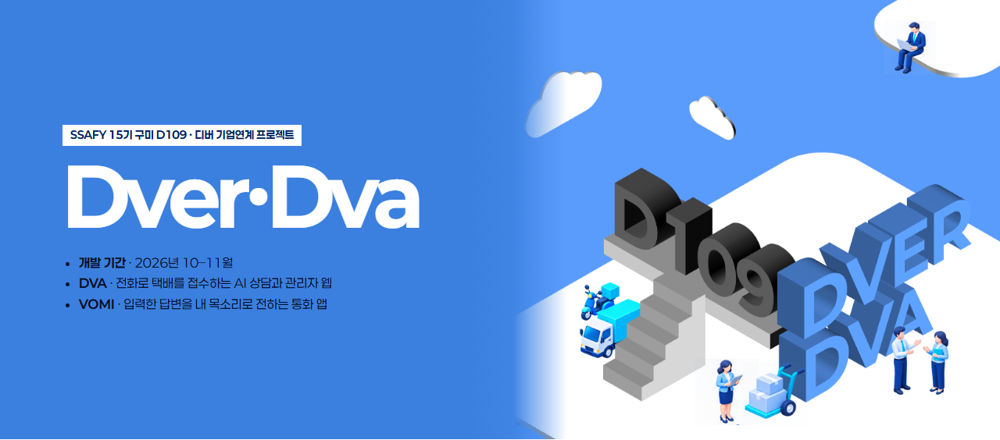
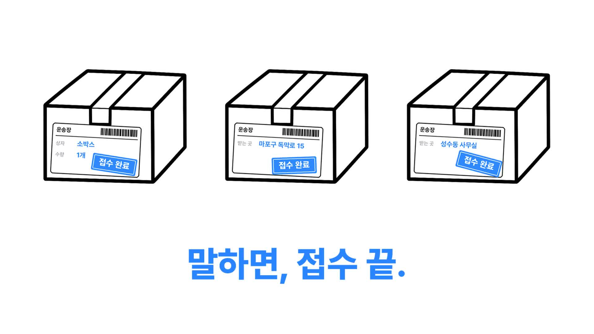
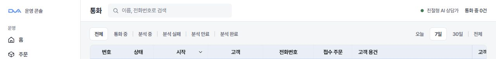
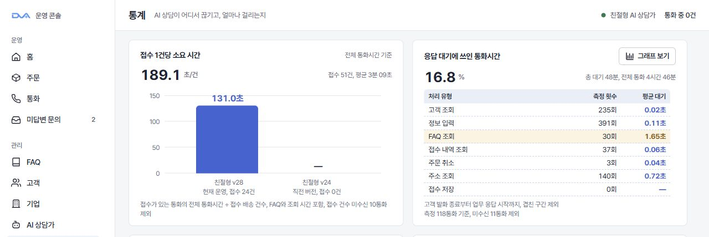
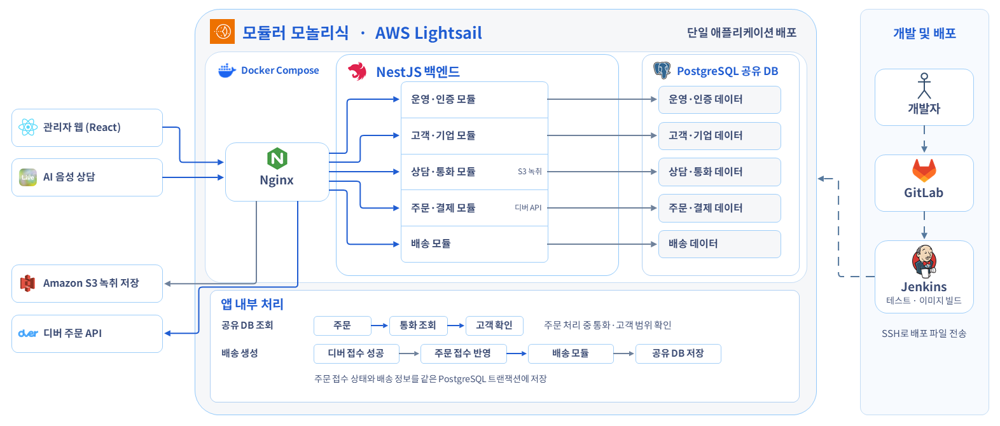
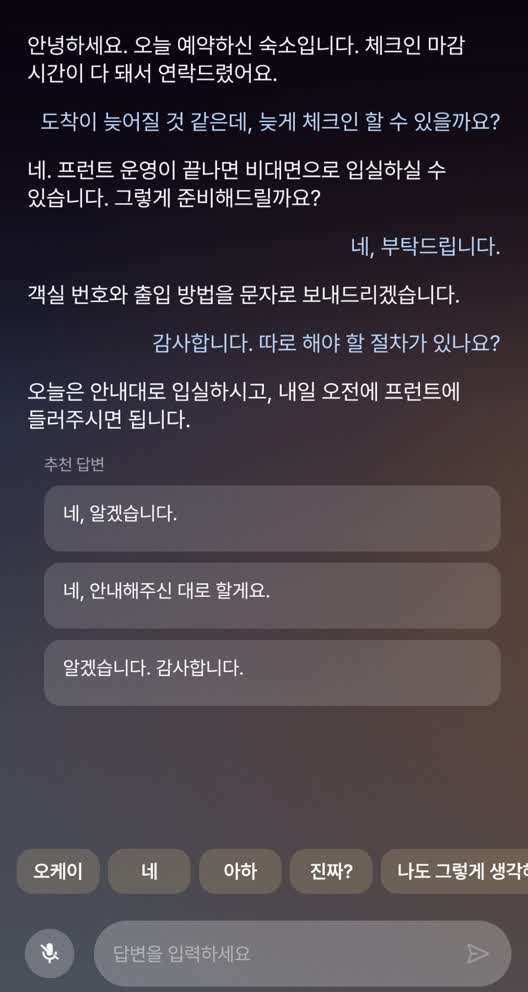

# Dver·Dva

**SSAFY 15기 구미 D109 · 디버(Dver) 기업연계 프로젝트**

- **개발 기간** · 2026년 10–11월
- **DVA(Dver Voice Assistant)** · 전화로 택배를 접수하는 AI 상담과 관리자 웹
- **VOMI** · 입력한 답변을 내 목소리로 전하는 통화 앱

[DVA](#dva) · [DVA AI 상담 기술](#dva-ai-상담-기술) · [VOMI](#vomi) · [기술 스택](#기술-스택) · [저장소 구조](#저장소-구조) · [팀원 소개](#팀원-소개) · [프로젝트 결과물](#프로젝트-결과물)

## DVA

**전화로 택배를 접수하는 AI 상담원과 관리자 웹**

- **고객**은 전화로 보내는 곳, 받는 곳, 물품 정보를 전달하고 AI 상담원과 접수 내용을 확인합니다.
- **백엔드**는 상담 결과를 저장하고 결제 방식에 맞춰 디버 주문 접수를 진행합니다.
- **운영자**는 관리자 웹에서 주문 상태, 통화 기록, 녹취를 확인합니다.

### 시연 영상

- [DVA 서비스 소개 영상 · 54초](assets/dva-intro.mp4) — 처음 접수하는 고객과 기존 주소를 이용하는 고객의 전화 접수 사례를 소개합니다.
- [AI 전화 상담 PoC · 39초](assets/dva-call-demo.mp4) · AI 상담원과 고객이 배송 정보를 확인하는 통화 시연입니다.

### 관리자 웹

[DVA 관리자 웹 열기](https://dva-d109.duckdns.org/) · 관리자 계정 로그인이 필요합니다.

#### 홈 · 처리할 일

미완료 주문, 접수 실패, 결제 대기, 미답변 문의를 한곳에서 확인합니다. [홈에서 보기](https://dva-d109.duckdns.org/)

#### 주문 · 접수 상태와 검색

주문번호·이름·전화번호·주소로 검색하고 접수 상태와 기간을 좁혀 확인합니다. [주문 페이지 열기](https://dva-d109.duckdns.org/orders)

#### 통화 · 상담 이력

고객 이름이나 전화번호로 검색하고, 통화 중·분석 중·분석 완료 등 상태별로 확인합니다. [통화 페이지 열기](https://dva-d109.duckdns.org/calls)

#### AI 상담가 · 목소리와 버전 관리

현재 통화에 사용 중인 상담가와 목소리를 확인하고, 수정 기록과 시나리오 시험을 엽니다. [AI 상담가 페이지 열기](https://dva-d109.duckdns.org/personas)

#### 통계 · 접수 시간과 응답 대기

접수 한 건에 걸린 시간과 업무 유형별 평균 응답 대기 시간을 살펴봅니다. [통계 페이지 열기](https://dva-d109.duckdns.org/stats)

### 주요 기능

- **실시간 AI 전화 상담** · 대화 중 배송 정보를 수집하고 빠진 내용을 되묻거나 고객의 정정을 반영합니다.
- **주문·결제 연동** · 상담 결과를 저장하고 결제 방식에 맞춰 디버에 주문을 접수합니다.
- **상담 운영** · 주문·통화 이력과 녹취를 확인하고 FAQ와 AI 상담 설정을 관리합니다.

### DVA 서비스 흐름

1. **전화 연결** · 고객이 디버에 전화하면 PBX가 상담 연결을 처리합니다. AI 에이전트는 발신번호로 등록 고객인지 확인합니다.
2. **배송 정보 확인** · 상담 중 출발지, 도착지, 받는 분과 물품 정보를 수집합니다. 등록 고객의 주소록을 활용하고, 빠진 항목이나 여러 후보가 있는 주소는 추가로 확인합니다.
3. **결제와 접수** · 고객이 최종 내용을 확인하면 AI가 상담 결과를 백엔드에 전달합니다. 개인 카드 주문은 결제를 기다리고, 기업 월결제·부서 그룹결제는 해당 조건을 확인한 뒤 처리합니다. 백엔드는 결제 완료 후 디버 주문 API를 호출합니다.
4. **운영 관리** · 운영자는 관리자 웹에서 결과를 확인합니다. 중간에 끝난 상담의 수집 정보는 미완료 주문으로 보관하며, 통화 종료 이벤트로 받은 녹취는 S3에 저장해 상담 기록과 연결합니다.

### DVA AI 상담 기술

실시간으로 듣고 말하는 경로와 주문 업무에 필요한 판단·값 추출 경로를 분리했습니다. 고객이 말을 고치거나 중간에 용건을 바꿔도 대화를 이어가면서 배송 정보를 확인할 수 있도록 설계했습니다.

GPT-Realtime-2.1 단일 모델과 LangGraph 기반 상담 흐름을 검토한 뒤, GPT-Live-1이 음성 대화를 맡고 업무 판단과 정보 추출을 별도 경로로 위임하는 구조를 적용했습니다.

| 구성 | 하는 일 |
| --- | --- |
| **GPT-Live-1 · Full-Duplex** | 디버 PBX에서 SIP로 연결된 통화에서 고객의 말을 듣고 응답합니다. 듣는 중에도 말할 수 있고, 고객이 끼어들거나 말을 정정하면 대화를 이어갑니다. 서버는 Live 세션의 이벤트를 WebSocket으로 받아 통화 상태를 관리합니다. |
| **Decisions API · `gpt-6-luna`** | 선택형 판단이 필요한 턴에 의도, 확인·정정 여부, 주소 후보 선택, 용건 변경을 판별합니다. FastAPI 서버가 발화와 대화 맥락을 전달하고 결과를 상담 상태에 반영합니다. |
| **Responses Delegation · 함수 도구** | 성함, 전화번호, 주소, 물품처럼 자유형 정보는 Live-1이 백엔드 모델에 위임합니다. 서버가 함수 인자와 현재 상태를 확인한 뒤 주소 보정, 주문 처리, FAQ 검색 등의 도구를 실행합니다. |

#### FAQ 검색과 답변 · RAG

1. FAQ의 **질문과 답변을 함께** `text-embedding-3-large`로 임베딩해 Qdrant에서 의미가 비슷한 문서를 찾습니다.
2. **Kiwi 형태소 분석 + BM25**로 핵심 단어를 검색합니다. 두 검색 순위를 가중 **RRF**로 합쳐 후보 **5개**를 고릅니다.
3. **Qwen3-Reranker-0.6B**가 질문과 후보의 관련성을 다시 평가합니다. 상위 **3개** FAQ를 Live-1의 답변 근거로 전달합니다.

#### 한국어 주소 인식과 보정

전화로 들은 주소에서 기본주소와 상세주소를 나누고, 한글 수사와 발음을 정규화합니다. 행정안전부 주소 DB(SQLite)의 실제 도로명·건물번호를 조회하고, 자모 단위 **레벤슈타인 거리**로 발음이 가까운 도로명 후보를 비교합니다. 후보가 서로 다른 시·군·구에 걸치면 지역을 다시 물어 범위를 좁힙니다.

#### 검색 품질과 판단 지연

| 평가 | 결과 | 측정 범위 |
| --- | --- | --- |
| Decisions API | 웜 호출 중앙값 **251ms**, P95 **284ms** | 통화 발화 재생 실험에서 연결 준비 이후 53개 호출 |
| FAQ 검색 리랭킹 | Top 1 **71% → 96%**, Top 3 **86% → 100%** | Dense + BM25 검색에 Qwen3 리랭킹을 추가하기 전후 비교 |
| RAGAS 답변 품질 | 근거 충실도 **0.8579**, 문맥 정밀도·재현율 각각 **0.9895**, 사실 정확성 **0.7214** | FAQ 답변 평가 |

### DVA 시스템 아키텍처

| 구성 | 역할 |
| --- | --- |
| 디버 PBX · Python AI 에이전트 | 전화 연결, 실시간 음성 응대, 주소 확인, FAQ 검색, 업무 API 호출 |
| React 관리자 웹 | 주문·상담 조회, FAQ 관리, AI 상담 설정과 시나리오 시험 |
| NestJS 업무 백엔드 | 고객, 회사, 상담, 주문, 결제를 처리하고 PG·디버 API와 연동 |
| PostgreSQL · Amazon S3 | PostgreSQL에 업무 데이터와 녹취 참조를 저장하고, 녹취 파일은 S3에 저장 |

#### 모듈러 모놀리스 · AWS Lightsail

**모듈러 모놀리스**는 Docker Compose 환경에서 하나의 NestJS 애플리케이션과 공유 PostgreSQL로 구성했습니다. 관리자 웹과 AI 에이전트는 Nginx를 거쳐 업무 API에 접근합니다.

#### MSA 검증 환경 · EC2와 k3s

**별도 MSA 검증 환경**은 운영·인증, 고객·기업, 상담·통화, 주문·결제, 배송을 다섯 서비스와 PostgreSQL DB로 나눴습니다. k3s와 Traefik Ingress로 배포하고, Outbox와 Inbox로 서비스 간 이벤트의 재전송과 중복 처리를 다뤘습니다.

### DVA ERD · 핵심 관계

| 기준 | 관계 |
| --- | --- |
| 고객 | 고객 한 명의 여러 주문을 연결합니다. |
| 주문 | 주문 한 건에 여러 배송 상세가 연결되며, 상담 이력에서도 연결된 주문을 확인할 수 있습니다. |
| 통화 | 통화 한 건에 여러 발화와 녹취를 연결하고, 통화 분석 결과는 통화별로 저장합니다. |

[모놀리스 상세 스키마](docs/database/monolith.dbml)

## VOMI

**말하기 어려운 순간, 입력한 답변을 내 목소리로 전하는 통화 앱**

조용한 공간이나 대중교통에서 전화를 받았을 때, 문장을 입력하거나 추천 답변을 골라 대화를 이어갈 수 있습니다. 상대방은 답변을 텍스트로 보고, 내가 등록한 목소리로도 들을 수 있습니다.

### 통화 화면과 음성 시연

통화 중 대화 내역을 보면서 추천 답변을 고르거나 문장을 직접 입력할 수 있습니다.

- [VOMI 음성 합성 비교 영상 · 13초](assets/vomi-voice-demo.mp4)
- **같은 문장 듣기** · [원본 녹음](assets/vomi-original.wav) · [ElevenLabs](assets/vomi-elevenlabs.wav) · [OmniVoice + LoRA](assets/vomi-omnivoice.wav)

### VOMI 서비스 흐름

1. **목소리 등록** · 사용자가 샘플 사용에 동의하고 음성을 등록합니다. 서버는 계정과 음성 모델 정보를 연결합니다.
2. **발신 및 수락** · 친구에게 전화를 걸고 상대가 수락하면 각 앱이 백엔드에서 입장 정보를 받아 같은 LiveKit 방에 연결합니다.
3. **답변 선택 또는 입력** · 통화 화면에서 추천 문장을 고르거나 직접 입력합니다. 전송한 텍스트는 합성을 기다리지 않고 상대 화면에 표시됩니다.
4. **합성 음성 재생** · 백엔드가 발신자의 등록 목소리로 음성 청크를 반환하면, 발신 앱이 LiveKit으로 전송하고 수신 앱이 재생합니다. 마이크를 음소거한 상태에서도 텍스트와 합성 음성을 전송할 수 있습니다.

### VOMI 음성 합성

| 경로 | 전달 방식 |
| --- | --- |
| 답변 표시 | 발신 앱 → LiveKit 텍스트 스트림 → 수신 앱에 즉시 표시 |
| 내 목소리로 합성 | 발신 앱 → NestJS 백엔드 → ElevenLabs 또는 OmniVoice 파일럿 → 발신 앱에 PCM 음성 반환 |
| 상대방 기기에서 재생 | 발신 앱 → LiveKit 바이트 스트림 → 수신 앱에서 도착한 음성 청크를 순서대로 재생 |

텍스트와 음성을 별도 스트림으로 전달합니다. 발신 앱은 합성 음성 전체가 완성되기를 기다리지 않고, 받은 청크부터 상대에게 전송합니다.

### 음성 모델 실험

- **모델 선택** · ElevenLabs로 통화 중 합성 음성 전달을 구현했습니다. 로컬 합성 후보 CosyVoice 3, GPT-SoVITS, OmniVoice에 같은 한국어 문장을 입력하고 발음과 합성 시간을 비교해 OmniVoice를 선택했습니다.
- **개인 말투 학습** · 부산 말투로 녹음한 2분 33초 분량을 53개 문장 클립으로 나누고 전사를 교정했습니다. OmniVoice를 LoRA로 미세조정하고, 학습에 쓰지 않은 문장으로 발음과 말투를 비교했습니다.
- **합성 시간 개선** · RTX 4070에서 50자 문장의 음성 합성 시간 중앙값이 FlashInfer 적용 전 **784ms**에서 적용 후 **412ms**로 줄었습니다.

## 기술 스택

| 영역 | DVA | VOMI |
| --- | --- | --- |
| 사용자 화면 | React · TypeScript | Android |
| 백엔드·저장소 | NestJS · PostgreSQL | NestJS · PostgreSQL |
| 음성·AI | Python · FastAPI · GPT-Live-1 · Decisions API · Responses Delegation · Qdrant · Kiwi/BM25 · RRF · Qwen3-Reranker | LiveKit · ElevenLabs · Gemini Nano · OmniVoice/LoRA 실험 |
| 배포·외부 연동 | AWS Lightsail · Docker Compose · Jenkins · Amazon S3 · k3s(MSA 검증) | LiveKit Cloud · Firebase Cloud Messaging · Docker Compose |

## 팀원 소개

- **[유민국](https://github.com/jlkim909)** · 팀장, DVA 백엔드, 주문 결제와 결제 완료 안내 연동
- **[김지우](https://github.com/Jiwoo-Kim0)** · DVA 관리자 웹과 AI 상담 화면, 상담가 설정과 버전 기록
- **[신지환](https://github.com/jihwan4155)** · DVA AI 전화 상담의 접수·확인 흐름, VOMI 온디바이스 PoC
- **[한태원](https://github.com/hantawon123)** · DVA 업무 백엔드·MSA·CI, VOMI 통화 백엔드와 음성 모델 연동
- **[현승준](https://github.com/sejhyun13)** · DVA 대화 제어, 주소·전화번호 처리 및 음성 모델 위임 흐름
- **[이재훈](https://github.com/42JH)** · DVA 관리자 웹, 주문·FAQ·AI 상담 설정과 시나리오 시험 UI

## 프로젝트 결과물

- **DVA** · [서비스 소개 영상](assets/dva-intro.mp4) · [전화 상담 PoC](assets/dva-call-demo.mp4) · [관리자 웹](https://dva-d109.duckdns.org/)
- **VOMI** · [앱 통화 화면](assets/vomi-call.jpg) · [음성 모델 비교 영상](assets/vomi-voice-demo.mp4)
- **설계 자료** · [DVA AI 상담 구조](assets/dva-ai-flow.png) · [DVA 모듈러 모놀리스](assets/dva-monolith.png) · [DVA MSA](assets/dva-msa.png)

[이전 DVA README 보기](docs/archive/README-dva-original.md)

## 저장소 구조

### DVA

- [`frontend/`](frontend/) · React 관리자 웹
- [`ai/`](ai/) · FastAPI 전화 상담 에이전트
  - [`app/calls/`](ai/app/calls/) · Live-1 세션과 상담 흐름
  - [`app/rag/`](ai/app/rag/), [`app/address/`](ai/app/address/) · FAQ 검색과 한국어 주소 보정
- [`backend/`](backend/) · NestJS 모듈러 모놀리스
  - [`src/`](backend/src/) · 상담, 고객·기업, 주문, 결제, 배송 모듈
  - [`migrations/`](backend/migrations/) · PostgreSQL 스키마 변경 이력
- [`msa/`](msa/) · 서비스 분리 및 배포
  - [`services/`](msa/services/) · `operations`, `customer`, `consultation`, `order`, `delivery`
  - [`liquibase/`](msa/liquibase/), [`deploy/`](msa/deploy/) · 서비스별 DB 변경 이력과 배포 설정

### VOMI

- [`kick/backend/`](kick/backend/) · 통화·친구·음성 합성 API와 LiveKit 연동
- [`kick/ai/`](kick/ai/) · 브라우저와 Android의 온디바이스 AI PoC
- [`kick/vomi/`](kick/vomi/) · Kotlin·Jetpack Compose Android 앱

### 인프라와 문서

- [`infra/`](infra/) · AWS, Nginx, Jenkins, 배포·관측 설정
- [`docs/`](docs/) · API 계약, DB 설계, Git 협업 규칙, 이전 README
- [`postman/`](postman/) · 외부 API 모의 응답과 시뮬레이션
- [`assets/`](assets/) · README 화면, 구조도, 영상, 음성 샘플
