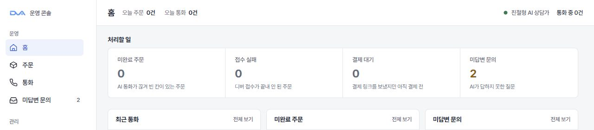
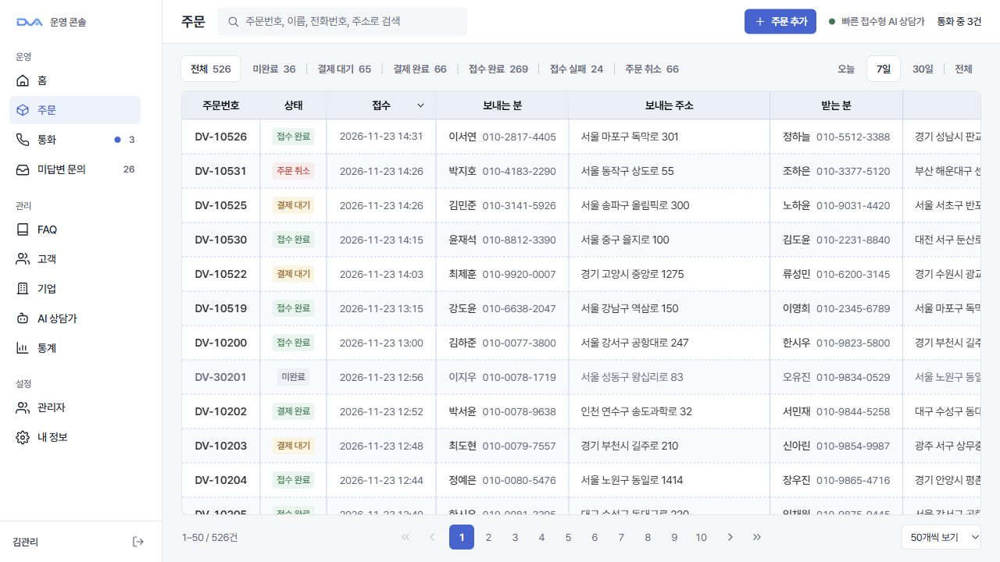
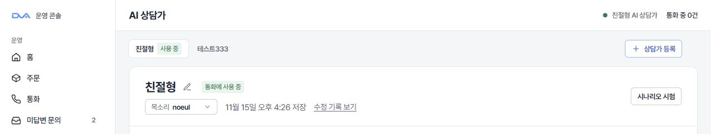
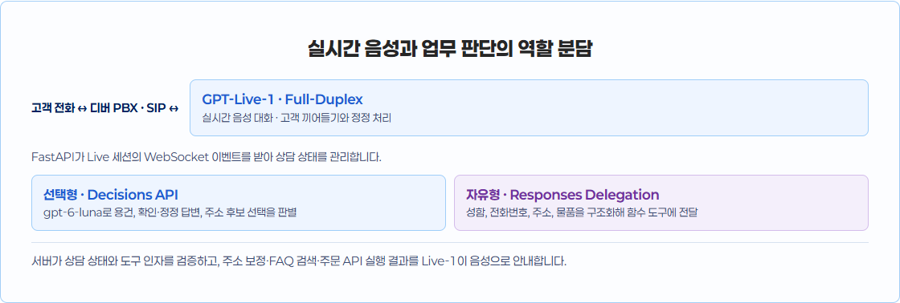
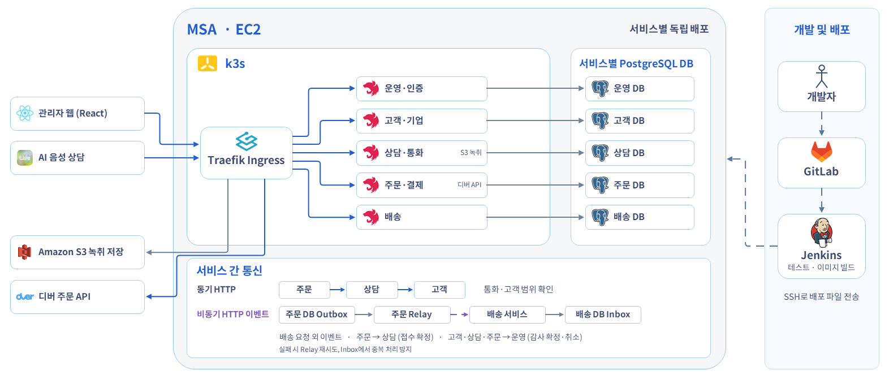
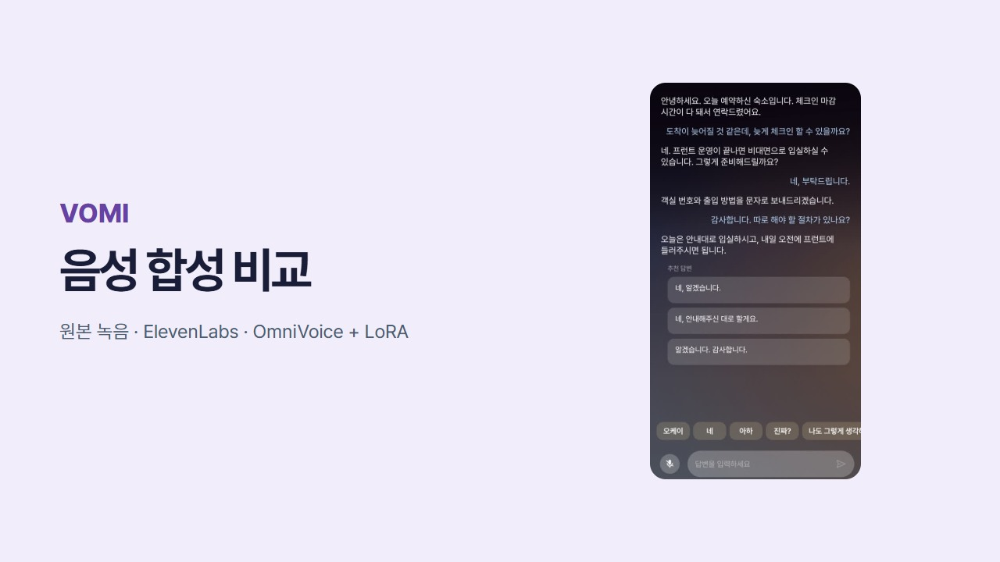

# Dver·Dva

**SSAFY 15기 구미 D109 · 디버(Dver) 기업연계 프로젝트** · 2026년 10–11월

[DVA](#dva) · [아키텍처](#아키텍처) · [VOMI](#vomi) · [기술 스택](#기술-스택) · [저장소 구조](#저장소-구조) · [팀원](#팀원)

## DVA

**전화로 택배를 접수하는 AI 상담원과 관리자 웹**

고객이 전화로 배송 정보를 말하면 AI가 주소와 물품을 확인합니다. 주문은 결제 조건에 맞춰 디버에 접수되며, 운영자는 웹에서 통화와 주문 내역을 확인합니다.

### 서비스 흐름

전화 연결 → 배송 정보 확인 → 결제·디버 접수 → 관리자 웹에서 확인

- 기존 고객의 주소록을 활용하고, 빠지거나 정정된 정보는 통화 중 다시 확인합니다.
- 통화가 중간에 끝나면 미완료 주문으로 남기고, 통화 녹취는 상담 기록에 연결합니다.

### 시연 영상

[서비스 소개 · 54초](assets/dva-intro.mp4) · [AI 전화 상담 PoC · 39초](assets/dva-call-demo.mp4)

### 관리자 웹

[DVA 관리자 웹 열기](https://dva-d109.duckdns.org/) · 관리자 계정 로그인 필요

| [홈](https://dva-d109.duckdns.org/) | [주문](https://dva-d109.duckdns.org/orders) |
| :---: | :---: |
|  |  |
| 처리할 일과 최근 활동 | 주문 검색과 접수 상태 |

| [통화](https://dva-d109.duckdns.org/calls) | [AI 상담가](https://dva-d109.duckdns.org/personas) | [통계](https://dva-d109.duckdns.org/stats) |
| :---: | :---: | :---: |
|  |  |  |
| 통화 이력과 녹취 | 목소리·버전·시나리오 | 접수 시간과 응답 대기 |

### AI 상담 기술

| 기술 | 역할 |
| --- | --- |
| **GPT-Live-1** | PBX로 들어오는 통화에서 양방향 음성 응대와 끼어들기 처리 |
| **Decisions API · `gpt-6-luna`** | 접수 의도, 확인·정정, 주소 후보 선택 판단 |
| **Responses Delegation** | 이름·전화번호·주소·물품 추출과 업무 도구 호출 |
| **FAQ 검색 · RAG** | Qdrant 임베딩과 Kiwi·BM25 검색을 RRF로 합친 뒤 Qwen3로 재정렬 |
| **한국어 주소 보정** | 도로명 주소 DB와 자모 단위 편집 거리로 주소 후보 검색 |

- **판단 응답** · Decisions API 웜 호출 중앙값 **251ms**, P95 **284ms** (53회)
- **FAQ 검색** · Qwen3 재정렬 적용 후 Top 1 **71% → 96%**, Top 3 **86% → 100%**

### 아키텍처

아래에서 구조를 선택하면 한 번에 한 장씩 볼 수 있습니다.

<strong>모듈러 모놀리스 · AWS Lightsail</strong>

Docker Compose에서 NestJS 모듈과 PostgreSQL을 함께 운영합니다. 관리자 웹과 AI 에이전트는 Nginx를 통해 업무 API에 접근합니다.

<strong>MSA 검증 환경 · EC2와 k3s</strong>

업무를 다섯 서비스와 개별 DB로 분리했습니다. k3s·Traefik으로 배포하고 Outbox·Inbox로 이벤트 재전송과 중복을 처리했습니다.

[모놀리스 ERD · DBML](docs/database/monolith.dbml)

## VOMI

**말하기 어려운 순간, 입력한 답변을 내 목소리로 전하는 통화 앱**

조용한 곳에서 전화를 받으면 추천 답변을 고르거나 직접 입력할 수 있습니다. 상대방은 텍스트를 바로 받고, 등록한 목소리로 합성한 답변도 듣습니다.

### 통화 화면과 시연

| 앱 통화 화면 | 음성 합성 비교 |
| :---: | :---: |
|  |  |
| 대화 내역 · 추천 답변 · 직접 입력 | [비교 영상 · 13초](assets/vomi-voice-demo.mp4) |

**같은 문장 듣기** · [원본 녹음](assets/vomi-original.wav) · [ElevenLabs](assets/vomi-elevenlabs.wav) · [OmniVoice + LoRA](assets/vomi-omnivoice.wav)

### 서비스 흐름

목소리 등록 → LiveKit 통화 연결 → 답변 선택·입력 → 상대방에게 텍스트와 음성 전달

- **텍스트**는 LiveKit 텍스트 스트림으로 즉시 표시합니다.
- **음성**은 NestJS 백엔드가 합성한 PCM 청크를 LiveKit 바이트 스트림으로 보내, 상대 앱에서 도착 순서대로 재생합니다.

### 음성 합성

- **ElevenLabs**로 통화 중 합성 음성 전송을 구현했습니다.
- **OmniVoice + LoRA**로 부산 말투를 학습했습니다. 한국어 녹음 2분 33초를 53개 클립으로 나눠 사용했습니다.
- **FlashInfer** 적용 후 RTX 4070에서 50자 문장 합성 시간 중앙값이 **784ms → 412ms**로 줄었습니다.

## 기술 스택

| 영역 | DVA | VOMI |
| --- | --- | --- |
| 화면 | React · TypeScript | Kotlin · Jetpack Compose |
| 서버·DB | NestJS · FastAPI · PostgreSQL | NestJS · PostgreSQL |
| 음성·AI | GPT-Live-1 · Decisions API · Qdrant · Qwen3 | LiveKit · ElevenLabs · Gemini Nano · OmniVoice |
| 배포·연동 | AWS Lightsail · S3 · Docker Compose · Jenkins · k3s | LiveKit Cloud · Firebase Cloud Messaging · Docker Compose |

## 저장소 구조

| 영역 | 경로 |
| --- | --- |
| DVA | [관리자 웹](frontend/) · [AI 에이전트](ai/) · [모놀리스](backend/) · [MSA](msa/) |
| VOMI | [Android 앱](kick/vomi/) · [통화 백엔드](kick/backend/) · [온디바이스 AI PoC](kick/ai/) |
| 공통 | [인프라](infra/) · [문서](docs/) · [Postman](postman/) · [README 미디어](assets/) |

## 팀원

|  |  |  |  |  |  |
| :---: | :---: | :---: | :---: | :---: | :---: |
| [유민국](https://github.com/jlkim909) | [김지우](https://github.com/Jiwoo-Kim0) | [신지환](https://github.com/jihwan4155) | [한태원](https://github.com/hantawon123) | [현승준](https://github.com/sejhyun13) | [이재훈](https://github.com/42JH) |
| 팀장 · 백엔드 주문·결제 | 관리자 웹 상담가 설정 | DVA 전화 상담 VOMI 온디바이스 | 백엔드·MSA·CI VOMI 통화·음성 | AI 대화 제어 주소·모델 위임 | 관리자 웹 주문·FAQ·시나리오 |

[이전 DVA README](docs/archive/README-dva-original.md)
