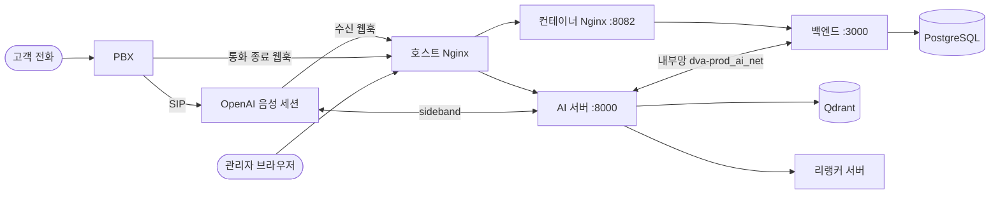
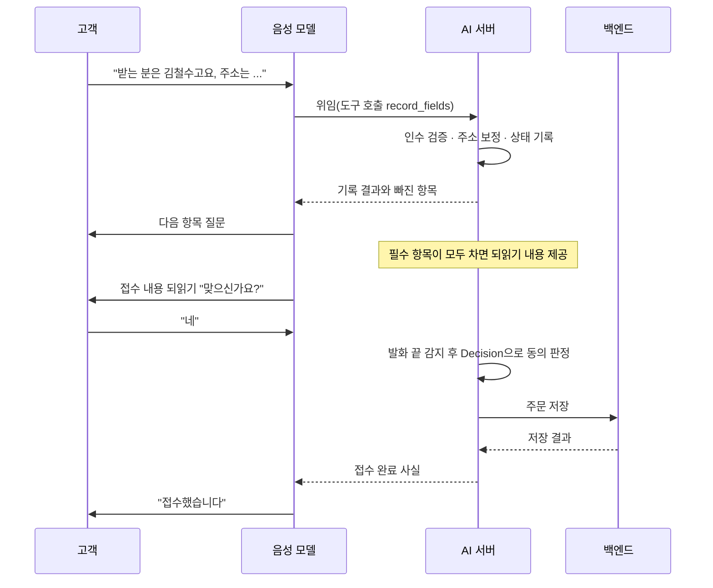
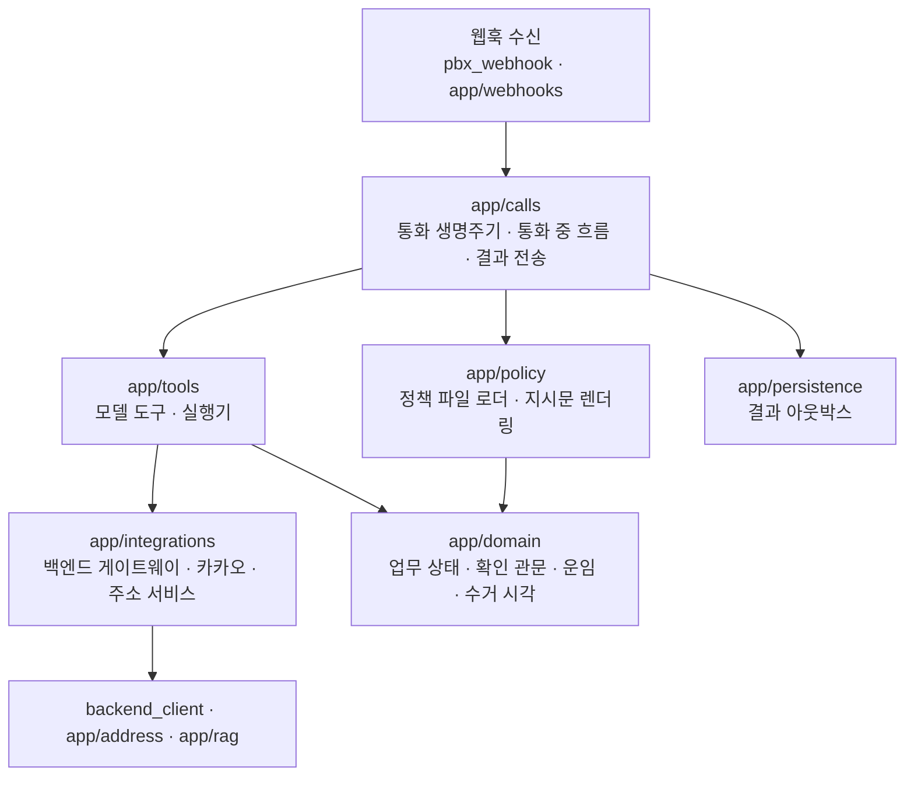
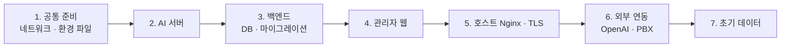

# AI 전화 접수 서비스 인계 문서

이 문서는 전화로 택배 접수·조회·취소·문의를 받는 AI 상담 서비스를 새 서버에 올리는 방법을 설명합니다. 저장소를 처음 보시는 개발자분이 이 문서만 따라가도 AI 서버를 백엔드·관리자 웹과 함께 동작시킬 수 있도록 작성했습니다. 모든 서비스는 Docker로 띄우는 것을 전제로 합니다.

- 대상 저장소 폴더는 `ai/`(AI 서버), `backend/`(백엔드), `frontend/`(관리자 웹), `infra/`(Nginx·DB·배포 스크립트)입니다.
- 본문은 `docker compose`를 직접 실행하는 수동 절차입니다. Jenkins 자동 배포는 9장에 따로 적었습니다.
- `<...>` 모양의 값은 직접 채우셔야 하는 자리입니다.

## 0. 인계 전 정리한 것

깔끔한 인계를 위해 개발 과정에서 쌓인 산출물을 `ai/` 폴더에서 정리했습니다. 운영에 쓰이는 코드와 계약 문서는 그대로입니다.

| 정리한 것 | 내용 |
|---|---|
| 테스트 파일 | 단위·계약 테스트와 픽스처 전부입니다. 필요하시면 pytest로 새로 작성하실 수 있습니다(11장) |
| 작업 내역 문서 | 작업 기록(worklog), 실험 결과 기록 |
| 아키텍처 설계 계획안 | 구현이 끝난 계획·감사·조사 문서, 재구성 전 분석 문서, 옛 흐름 엔진 문서 |
| 이전 버전 코드 | 재작성 전 서버 폴더 |
| 임시 관제 화면 | 개발 중 통화를 눈으로 확인하던 화면과 그 연결 코드 |
| 평가 도구 | 검색·주소 보정 품질을 재던 스크립트와 평가 데이터 |
| 서버 주소 | 배포 서버·리랭커 서버 주소와 클라우드 프로젝트 이름을 플레이스홀더로 바꿨습니다 |

남긴 것 중 알아 두실 점은 다음과 같습니다.

- `AGENTS.md`, `CLAUDE.md`는 개발 중 쓰던 AI 코딩 도구용 지침입니다. 필요에 따라 지우거나 다시 쓰셔도 됩니다.
- `call_analysis/tests/test_call_analysis.py` 하나는 남겼습니다. 백엔드의 `scripts/record-complaint-parity.py`가 실행하는 기준 테스트입니다.
- `backend_client/`에는 백엔드 계약에 맞춰 구현했지만 현재 통화 흐름이 호출하지 않는 메서드가 일부 있습니다(주문 수정, 주소록 목록·수정 등).
- 남은 설계 문서 일부는 본문에서 정리된 문서 이름을 언급합니다. 해당 링크는 열리지 않습니다.

## 1. 전체 구성

### 1.1 구성 요소

| 구성 요소 | 하는 일 | 실행 형태 | 포트 |
|---|---|---|---|
| AI 서버 | 전화를 받아 음성으로 응대하고 백엔드 API로 업무를 처리합니다 | compose 프로젝트 `dva-ai` | `127.0.0.1:8000` |
| Qdrant | FAQ 검색용 벡터 DB | `dva-ai` 안의 서비스 | 호스트에 열지 않음 |
| 백엔드 | 고객·주문·주소록·FAQ·페르소나·통화 기록 API | compose 프로젝트 `dva-prod` | 컨테이너 내부 3000 |
| PostgreSQL | 백엔드 DB | `dva-prod` 안의 서비스 | 호스트에 열지 않음 |
| 컨테이너 Nginx | 백엔드 앞단 | `dva-prod` 안의 서비스 | `127.0.0.1:8082` |
| 관리자 웹 | 주문·통화·FAQ·페르소나 관리 화면 | 정적 파일(호스트 Nginx가 제공) | — |
| 호스트 Nginx | TLS 종단, 경로별 분배 | 서버에 직접 설치 | 80, 443 |
| 시험 창구(선택) | 페르소나 적용 전 시나리오 통화 시험 | compose 프로젝트 `dva-persona-check` | 호스트에 열지 않음 |
| 리랭커(선택) | FAQ 검색 결과 재순위 | 별도 GPU 서버 | HTTPS |

저장소의 `msa/`와 `kick/`은 이 서비스와 별개인 트랙입니다. 이 문서의 배포에는 필요하지 않습니다.

### 1.2 연결 구조



- AI 서버와 백엔드는 Docker 네트워크 `dva-prod_ai_net`으로 서로를 호출합니다. 이 네트워크 안에서 AI는 `http://ai:8000`, 백엔드는 `http://backend:3000`입니다.
- 외부에서 들어오는 요청은 모두 호스트 Nginx를 거칩니다. AI 서버와 백엔드 컨테이너는 `127.0.0.1`에만 포트를 엽니다.
- PBX의 통화 종료 웹훅은 백엔드 주소로 한 번만 오고, 호스트 Nginx가 같은 요청을 AI 서버에도 복사합니다.

### 1.3 전화 한 통의 경로

1. 고객이 대표번호로 전화하면 PBX가 통화를 OpenAI의 SIP 주소로 넘깁니다.
2. OpenAI가 AI 서버의 수신 웹훅을 호출합니다. AI 서버는 서명을 확인하고 백엔드에서 발신번호로 고객을 조회한 뒤 통화를 수락합니다.
3. 통화 중에는 OpenAI 음성 모델이 고객과 대화하고, AI 서버는 sideband 연결로 통화를 지켜보면서 값 기록·조회·검증을 맡습니다.
4. 접수가 확정되면 AI 서버가 백엔드에 주문을 저장합니다.
5. 통화가 끝나면 AI 서버가 통화 기록과 분석 결과를 백엔드로 보냅니다. PBX는 녹취 정보를 담은 종료 웹훅을 보냅니다.
6. 관리자는 관리자 웹에서 주문·통화 기록·미답변 질문을 확인합니다.

## 2. AI 서버 아키텍처

### 2.1 역할 분담

AI 서버의 핵심 원칙은 **말은 음성 모델이 하고, 업무 사실은 서버가 확정한다**는 것입니다.

| 주체 | 맡는 일 |
|---|---|
| 음성 모델(`gpt-live-1`) | 한국어 대화, 끼어들기 응대, 다음에 물을 것 진행, 서버가 준 결과를 고객에게 안내 |
| 위임 모델(`BACKEND_MODEL`, 기본 `gpt-6-luna`) | 고객 말에서 값(성함·전화번호·주소·물품 등)을 뽑아 도구를 호출 |
| Decision 호출(`gpt-6-luna`) | 예/아니요, 후보 선택처럼 정해진 선택지 중 무엇인지 판정 |
| AI 서버(애플리케이션) | 인수 검증, 업무 상태 관리, 확인 관문, 백엔드 API 호출, 장애 복구, 결과 전송 |

모델이 절차를 건너뛰어도 빠진 값이 있는 주문은 확정되지 않습니다. 서버가 필수 항목이 모두 찼을 때만 되읽기 내용을 내주고, 고객이 그 내용에 동의했을 때만 저장하기 때문입니다.

### 2.2 통화 중 처리 흐름



- 값을 기록하는 일(자유로운 말에서 값 뽑기)은 위임 모델과 도구가 맡습니다.
- 예/아니요 같은 선택형 판단은 서버가 고객 발화가 끝난 시점에 Decision 호출로 직접 판정합니다.
- 접수 확정과 취소는 모델이 부를 수 있는 도구가 아닙니다. 서버가 확인 관문을 통과한 뒤에만 실행합니다.
- 접수 요청부터 백엔드 저장 결과가 나올 때까지 음성 모델에게 완료를 알리지 않습니다. 저장이 끝난 뒤에만 "접수했습니다"가 나갑니다.

### 2.3 모듈 구조



| 폴더 | 책임 |
|---|---|
| `app/main.py` | 서버를 조립합니다. 공유 HTTP 클라이언트, 라우터, 백그라운드 작업을 만들고 종료 때 닫습니다 |
| `pbx_webhook/`, `app/webhooks/` | 외부에서 들어오는 요청을 받습니다(OpenAI 수신, PBX 종료, 백엔드의 FAQ·페르소나 알림) |
| `app/calls/` | 통화 한 통의 수신부터 정리까지 담당합니다. 통화 중 도구 호출 처리, 확인 관문, 결과·기록 전송, 페르소나 적용이 여기 있습니다 |
| `app/domain/` | 업무 상태와 규칙입니다. 외부 SDK나 HTTP에 의존하지 않습니다 |
| `app/policy/` | `policy/workflow.toml`을 읽어 음성 모델·위임 모델의 지시문과 서버 판정 규칙을 함께 만듭니다 |
| `app/tools/` | 모델이 부르는 도구 5개와 서버 전용 동작(취소 등), 인수 검증과 실행 |
| `app/integrations/` | 백엔드 호출 게이트웨이(타임아웃·동시성 제한), 카카오 주소 검색, 주소 보정 서비스 |
| `backend_client/` | 백엔드 API 클라이언트와 메모리 가짜 백엔드 |
| `app/address/` | 행정안전부 주소DB로 들은 주소를 실제 주소로 보정합니다 |
| `app/rag/` | FAQ 검색(키워드 + 벡터 검색, 리랭커), 백엔드 FAQ와의 동기화 |
| `app/persistence/` | 통화 결과·기록을 전송 전에 SQLite에 저장하는 아웃박스 |

### 2.4 업무 상태와 확인 관문

- 통화마다 업무 상태 객체가 하나 있습니다. 접수 항목별 값, 검증 상태, 버전이 들어 있습니다.
- 접수 단계와 필수 항목, 확인 질문은 `policy/workflow.toml`에 정의합니다. 같은 파일에서 모델 지시문과 서버 판정 규칙을 만들기 때문에 둘이 어긋나지 않습니다.
- 되읽기는 서버가 필수 항목이 모두 찼을 때 만든 확인 내용으로만 합니다. 고객이 동의한 뒤 값이 바뀌었으면 확인을 다시 받습니다.
- 모델이 만든 도구 인수는 신뢰하지 않습니다. 형식 검증을 통과한 뒤에만 실행합니다.

### 2.5 결과 전송과 장애 대비

- 통화 결과와 기록은 보내기 전에 아웃박스(`state/outbox.sqlite3`)에 저장합니다. 서버가 재시작돼도 같은 키와 같은 본문으로 다시 보내므로 주문이 중복 생성되지 않습니다.
- 백엔드 호출에는 모두 타임아웃이 있습니다. 백엔드 장애는 고객 입력 오류와 구분해 처리합니다.
- Qdrant나 리랭커가 죽어도 서버는 뜨고 접수 통화는 계속 받습니다. FAQ 검색만 "자료 없음"으로 답합니다.
- 주소DB가 없으면 주소 보정 없이 들은 그대로 씁니다.

### 2.6 동시 통화

- 통화 상태가 프로세스 메모리에 있으므로 **AI 서버는 워커 1개로만 띄웁니다.** 여러 통화는 하나의 이벤트 루프에서 통화당 수신 작업 1개로 처리합니다.
- 동시 통화 상한은 `config/server.toml`의 `[call] max_active_calls`(기본 20)입니다.
- 컨테이너를 다시 만들면 진행 중인 통화가 끊깁니다. 재배포는 통화가 없는 시간에 하시기 바랍니다.

### 2.7 FAQ 검색

- 매뉴얼 원문(`manuals/`)이나 백엔드에서 관리하는 FAQ를 Qdrant에 색인하고, 질문이 오면 키워드 검색과 벡터 검색을 합친 뒤 리랭커로 다시 순위를 매깁니다.
- 임베딩 모델은 `text-embedding-3-large`, 리랭커는 별도 GPU 서버의 `Qwen3-Reranker-0.6B`입니다.
- 백엔드의 FAQ 관리 화면에서 FAQ가 바뀌면 백엔드가 AI 서버에 알리고, AI 서버가 원문을 다시 받아 색인합니다(FAQ 동기화, 기본 꺼짐).

### 2.8 함께 배포되는 보조 서비스

| 서비스 | 용도 |
|---|---|
| 시험 창구(`persona_check/`) | 관리자가 페르소나를 적용하기 전에 가짜 고객과의 시나리오 통화로 시험합니다. 백엔드가 호출합니다 |
| 통화 불만 판정(`call_analysis/`) | 끝난 통화의 불만·응대 오류를 판정합니다. 실서비스 구현은 백엔드 안에 있고, 이 폴더는 그 기준 구현입니다. 따로 띄우실 필요는 없습니다 |

더 자세한 설계는 `ai/docs/architecture/overview.md`에서 시작하시면 됩니다.

## 3. 준비물

### 3.1 서버

- Linux 서버 1대(x86-64)가 필요합니다. Docker Engine과 Docker Compose 플러그인, Nginx, certbot을 설치합니다.
- 외부에 여는 포트는 80과 443뿐입니다.
- 도메인 이름이 필요합니다. OpenAI는 IP 주소로 된 URL로 웹훅을 보내지 않습니다.

### 3.2 외부 서비스와 키

| 서비스 | 쓰는 곳 | 준비할 것 |
|---|---|---|
| OpenAI | AI 서버(음성·위임·임베딩), 백엔드(통화 불만 판정) | API 키, 프로젝트 ID, 웹훅 비밀값. 프로젝트에서 실시간 음성 SIP가 켜져 있어야 합니다 |
| PBX(SIP 사업자) | 전화 수신, 통화 종료 웹훅 | SIP 트렁크 설정 권한, 웹훅에 넣을 공유 토큰 |
| 카카오 로컬 API | AI 서버(지번·우편번호 조회) | REST API 키(선택) |
| 디버 접수 API | 백엔드(완성된 주문 접수) | API 주소와 키 |
| AWS S3 | 백엔드(녹취 저장) | 버킷, 접근 키 |
| 토스페이먼츠 | 백엔드(결제, 선택) | 클라이언트 키, 시크릿 키 |
| GPU 서버 | 리랭커(선택) | 9.3절을 참고하시기 바랍니다 |

## 4. 배포 절차

### 4.1 순서



**AI 서버를 백엔드보다 먼저 띄웁니다.** 백엔드의 준비 상태 확인(`/health/ready`)이 AI 서버의 `/health`를 호출하므로, AI 서버가 없으면 백엔드가 준비되지 않은 것으로 판정됩니다.

### 4.2 공통 준비

```bash
git clone <저장소 주소> dva && cd dva

# AI 서버와 백엔드를 잇는 네트워크. 두 compose가 모두 외부 네트워크로 사용합니다
docker network create dva-prod_ai_net
```

토큰은 길고 무작위한 값으로 만듭니다. 아래 명령으로 64자리 값을 만들 수 있습니다.

```bash
openssl rand -hex 32
```

AI 서버와 백엔드에 **같은 값**을 넣어야 하는 토큰은 5.2절 표에 있습니다. 먼저 만들어 두시면 편합니다.

### 4.3 AI 서버

```bash
cd ai
cp .env.example .env     # 값 채우기(5.1절)
```

`.env`에서 반드시 채우셔야 하는 값은 다음과 같습니다.

| 변수 | 값 |
|---|---|
| `OPENAI_API_KEY` | OpenAI API 키 |
| `OPENAI_WEBHOOK_SECRET` | OpenAI 웹훅 비밀값(`whsec_...`). 4.7절에서 웹훅을 등록하면 받습니다 |
| `PBX_WEBHOOK_SECRET` | PBX 공유 토큰. 백엔드의 `PBX_WEBHOOK_TOKEN`과 같은 값 |
| `BACKEND_API_URL` | `http://backend:3000` |
| `QDRANT_API_KEY` | 새로 만든 무작위 값 |
| `AI_BUSINESS_TOKEN`, `AI_INSIGHTS_TOKEN`, `AI_PERSONA_TOKEN` | 백엔드와 같은 값 |

이미지를 빌드하고 띄웁니다.

```bash
docker build --platform linux/amd64 --tag dva-ai-server:1 .

AI_IMAGE=dva-ai-server:1 docker compose --project-name dva-ai \
  -f compose.yaml -f deploy/compose.deploy.yaml \
  up -d --no-build --wait

curl http://127.0.0.1:8000/healthz      # {"ok":true}
```

- `--project-name dva-ai`를 꼭 붙여 주시기 바랍니다. 시험 창구가 이 이름으로 만들어진 볼륨과 네트워크(`dva-ai_rag_state`, `dva-ai_rag_net`)를 찾습니다.
- `deploy/compose.deploy.yaml`이 AI 서버를 `dva-prod_ai_net`에 `ai`라는 이름으로 붙이고, 통화 기록을 볼륨 `ai_logs`에 남깁니다.
- 백엔드가 아직 없어도 AI 서버는 뜹니다. 백엔드 호출만 실패합니다.
- 백엔드 없이 동작을 확인하시려면 `.env`에 `BACKEND_MOCK=true`를 넣습니다(메모리 가짜 백엔드). 운영에서는 비우거나 `false`로 둡니다.

만들어지는 것은 다음과 같습니다.

| 종류 | 이름 | 내용 |
|---|---|---|
| 컨테이너 | `dva-ai-ai-1`, `dva-ai-qdrant-1` | AI 서버, Qdrant |
| 볼륨 | `dva-ai_qdrant_data` | FAQ 색인 |
| 볼륨 | `dva-ai_rag_state` | FAQ 동기화 대기열 |
| 볼륨 | `dva-ai_ai_state` | 결과 전송 아웃박스 |
| 볼륨 | `dva-ai_ai_logs` | 통화 기록(개인정보) |

### 4.4 백엔드

저장소 루트에서 진행합니다. 먼저 환경 파일 `backend.env`를 만듭니다(이름은 자유롭게 정하셔도 됩니다).

```bash
BACKEND_IMAGE=dva-backend:1
DB_USER=<DB 사용자>
DB_PASSWORD=<DB 비밀번호>
DB_NAME=<DB 이름>
SECURITY_LOG_HMAC_KEY=<64자리 hex>
PBX_WEBHOOK_TOKEN=<PBX 공유 토큰>
CORS_ORIGINS=https://<도메인>
AI_BUSINESS_TOKEN=<AI와 같은 값>
AI_INSIGHTS_TOKEN=<AI와 같은 값>
AI_PERSONA_TOKEN=<AI와 같은 값>
AI_FAQ_TOKEN=<AI와 같은 값>
CALL_ANALYSIS_OPENAI_API_KEY=<통화 불만 판정용 OpenAI 키>
DVER_API_URL=<디버 접수 API 주소>
DVER_API_KEY=<디버 접수 API 키>
S3_RECORDINGS_BUCKET=<녹취 버킷>
AWS_ACCESS_KEY_ID=<키>
AWS_SECRET_ACCESS_KEY=<키>
RECORDING_ALLOWED_HOSTS=<PBX 녹취 파일 호스트>
```

- 맨 위 여섯 줄(`BACKEND_IMAGE`, `DB_USER`, `DB_PASSWORD`, `DB_NAME`, `SECURITY_LOG_HMAC_KEY`, `PBX_WEBHOOK_TOKEN`)이 없으면 compose가 시작하지 않습니다.
- 전체 변수와 형식 규칙은 `backend/.env.example`에 있습니다. AI 연동 토큰 4개는 32자 이상이어야 합니다.
- `AI_AGENT_URL`은 compose가 `http://ai:8000`으로 고정합니다. 따로 넣지 않으셔도 됩니다.

이미지를 빌드하고, DB를 먼저 띄워 마이그레이션을 적용한 뒤 전체를 띄웁니다.

```bash
docker build --platform linux/amd64 --tag dva-backend:1 ./backend

compose() { docker compose --project-name dva-prod --env-file backend.env -f compose.prod.yaml "$@"; }

compose up -d --wait db
sh infra/database/migrate.sh --no-backup dva-prod-db-1
compose up -d --wait

curl http://127.0.0.1:8082/api/health
```

- 백엔드 앱은 시작할 때 마이그레이션 001만 적용합니다. 002 이후는 `infra/database/migrate.sh`가 적용하므로 **이 단계를 건너뛰면 업무 API가 동작하지 않습니다.**
- `migrate.sh`는 적용한 파일의 체크섬을 DB에 기록합니다. 이미 적용된 파일을 고치면 다음 실행이 실패합니다.
- `--no-backup`은 처음 설치할 때만 씁니다. 이후 재배포에서는 옵션 없이 실행해 적용 전에 DB를 백업하시기 바랍니다(백업 폴더는 두 번째 인수이며 기본값은 `~/dva-deploy/shared/db-backups`입니다).

### 4.5 관리자 웹

관리자 웹은 컨테이너로 띄우지 않습니다. 빌드한 정적 파일을 호스트 Nginx가 제공합니다. 빌드에만 Node 컨테이너를 사용합니다.

```bash
docker run --rm -v "$PWD/frontend":/app -w /app node:24 sh -c "npm ci && npm run build"
rm -f frontend/dist/mockServiceWorker.js     # 개발용 목 서버 파일

sudo mkdir -p /var/www/dva
sudo cp -r frontend/dist/. /var/www/dva/
```

- 운영 빌드에는 환경 파일이 필요하지 않습니다. API는 화면과 같은 주소의 `/api`로 호출합니다.
- 로그인하려면 화면 주소가 백엔드의 `CORS_ORIGINS`에 들어 있어야 합니다.
- 운영 빌드의 통계 화면은 목데이터를 보여 줍니다(`frontend/src/features/stats/api/dashboardApi.ts`의 `STATS_DEMO`).

### 4.6 호스트 Nginx와 TLS

호스트 Nginx가 TLS를 종단하고 경로에 따라 요청을 나눕니다. 저장소의 `infra/https/https.conf`가 기준 설정입니다. 이 파일의 `server_name`과 인증서 경로를 새 도메인에 맞게 바꿔 사용하시면 됩니다.

꼭 있어야 하는 경로는 다음과 같습니다.

| 경로 | 보낼 곳 | 설명 |
|---|---|---|
| `POST /api/webhooks/openai/call-incoming` | `127.0.0.1:8000` | OpenAI 전화 수신 웹훅 → AI 서버 |
| `POST /api/webhooks/pbx/call-ended` | `127.0.0.1:8082` + AI 복사 | PBX 종료 웹훅 → 백엔드. `mirror`로 `127.0.0.1:8000/pbx/webhook/call-ended`에도 보냅니다 |
| `/api/` | `127.0.0.1:8082` | 백엔드 API |
| `/` | `/var/www/dva` | 관리자 웹. 없는 경로는 `index.html`로 돌립니다 |

주의하실 점은 다음과 같습니다.

- 호스트 Nginx 설정에 `/monitor` 블록이 있으면 지워 주시기 바랍니다. 관제 화면은 정리했기 때문에 AI 서버에 그 경로가 없습니다.
- 관리자 웹 블록은 `infra/https/https.conf`에 없습니다. `frontend/deploy/nginx-admin-web.conf`에 참고용 사본이 있습니다.
- `/api/health/ready`와 `/internal`로 시작하는 경로는 외부에 열지 않습니다. AI 서버의 `/internal/*`은 백엔드만 내부망으로 호출합니다.
- 컨테이너 Nginx 설정(`infra/nginx/default.prod.conf`)의 `underscores_in_headers on`은 지우지 마시기 바랍니다. AI 서버가 보내는 `call_session_seq` 헤더에 필요합니다.

인증서는 도메인이 있으면 certbot으로 받습니다.

```bash
sudo certbot --nginx -d <도메인>
```

### 4.7 외부 연동

**OpenAI**

1. OpenAI 프로젝트 설정에서 웹훅을 등록합니다. 주소는 `https://<도메인>/api/webhooks/openai/call-incoming`, 구독 이벤트는 `live.transport.incoming`입니다.
2. 등록할 때 받은 비밀값(`whsec_...`)을 AI 서버 `.env`의 `OPENAI_WEBHOOK_SECRET`에 넣고 AI 서버를 다시 띄웁니다.

**PBX**

1. SIP 트렁크의 목적지를 `sip:<OpenAI 프로젝트 ID>@sip.api.openai.com;transport=tls`로 설정합니다. 시그널링은 TLS(5061), 미디어는 SRTP여야 합니다.
2. 방화벽에서 OpenAI 미디어 대역(UDP)을 허용합니다. 대역 목록은 `ai/docs/be-contract/ai/pbx-sip.md`에 있습니다.
3. 통화 종료 웹훅을 `https://<도메인>/api/webhooks/pbx/call-ended`로 보내도록 설정하고, `Authorization: Bearer <PBX 공유 토큰>`을 붙입니다.

웹훅 본문 형식과 응답 코드는 `ai/docs/contracts/pbx-webhooks.md`와 `infra/webhooks/PBX-CALL-ENDED.md`에 있습니다.

### 4.8 초기 데이터

**최초 관리자 계정**

`backend/scripts/bootstrap-admin.cjs`가 관리자를 만듭니다. 운영 이미지에는 이 스크립트가 들어 있지 않으므로, 컨테이너에 복사해서 실행합니다. 비밀번호는 표준 입력으로 넣습니다.

```bash
docker cp backend/scripts/bootstrap-admin.cjs dva-prod-backend-1:/app/scripts/bootstrap-admin.cjs
echo '<비밀번호>' | docker exec -i dva-prod-backend-1 node scripts/bootstrap-admin.cjs <로그인ID> <이름>
```

이 방법은 저장소에 문서화된 절차가 아니라 스크립트를 읽고 정리한 것입니다. 실제 서버에서 확인하지 않았으므로, 동작하지 않으면 스크립트의 요구 사항(DB 접속 환경변수, `dist/auth/password`)을 확인해 주시기 바랍니다.

**주소DB(권장)**

주소DB는 고객이 말한 주소를 실제 도로명주소로 보정하고 지번·법정동·우편번호를 채우는 데 사용합니다. 행정안전부가 배포하는 주소 텍스트 파일을 SQLite 파일(`address.db`) 하나로 변환해서 씁니다.

없을 때의 동작은 다음과 같습니다.

- 서버는 정상적으로 뜨고 통화도 받습니다. 주소는 보정 없이 들은 그대로 기록합니다.
- 지번·우편번호가 비어 접수 결과가 미완성으로 처리될 수 있습니다. `KAKAO_REST_API_KEY`가 있으면 카카오 주소 검색으로 보완합니다.

원본 파일은 한 폴더에 아래 네 종류가 모두 있어야 합니다.

| 파일 | 내용 |
|---|---|
| `개선_도로명코드_전체분.txt` | 전국 도로명 코드(1개) |
| `주소_<시도>.txt` | 시도별 건물 주소 |
| `지번_<시도>.txt` | 시도별 지번 |
| `부가정보_<시도>.txt` | 시도별 행정동·우편번호·건물명 |

- 원본은 행정안전부 주소기반산업지원서비스의 주소 내려받기 화면(https://business.juso.go.kr/jst/jstAddressDownload)에서 "주소DB" 전체분 자료를 받으시면 됩니다. 변동분이 아니라 전체분이어야 합니다. 파일 형식은 그 자료에 포함된 "주소DB 활용방법" 가이드의 붙임1을 기준으로 합니다.
- 원본은 CP949 인코딩 그대로 두셔야 합니다. UTF-8로 바꿔 저장하면 변환이 실패합니다.

변환은 AI 서버 이미지로 실행합니다. 한 번만 하면 되고 10분 남짓 걸립니다. 결과 파일은 약 1GB입니다.

```bash
cd ai
mkdir -p data
docker run --rm --user root \
  -v <원본 폴더 절대 경로>:/src:ro -v "$PWD/data":/out \
  dva-ai-server:1 /app/.venv/bin/python -X utf8 -m app.address.gazetteer /src /out/address.db
```

- 진행하면서 시도별 건물·지번 건수를 출력하고, 마지막에 이름 색인 건수를 출력하면 완료된 것입니다.
- 중간에 실패하면 만들다 만 `data/address.db`가 남습니다. 지우고 다시 실행해 주시기 바랍니다.
- Docker 없이 실행하실 때는 `uv run python -X utf8 -m app.address.gazetteer <원본 폴더> data/address.db`를 사용합니다.

적용 방법은 다음과 같습니다.

- 파일을 `ai/data/address.db`에 두면 compose가 컨테이너의 `/app/data`에 읽기 전용으로 붙입니다. 다른 폴더에 두시려면 `.env`의 `ADDRESS_DATA_DIR`에 그 폴더를 적습니다.
- AI 서버는 시작할 때 파일을 엽니다. 파일을 새로 넣거나 바꾼 뒤에는 AI 서버 컨테이너를 다시 시작해야 합니다.
- 적용됐는지는 로그로 확인합니다. `docker logs dva-ai-ai-1`에 "주소 보정 켜짐: /app/data/address.db"가 보이면 적용된 것입니다. "주소DB가 없어 주소 보정을 끕니다"라는 경고가 보이면 파일 위치를 확인해 주시기 바랍니다.

갱신하실 때는 다음을 참고하시기 바랍니다.

- 주소DB 자료가 새로 배포되면 새 원본으로 다시 변환해 파일을 교체합니다.
- 코드의 DB 구조가 바뀐 버전으로 올리실 때도 다시 변환해야 합니다. 옛 구조의 파일은 서버가 거부하므로 기동이 실패합니다.

이 절차는 이번 인계 작업에서 2026년 9월 30일 기준 전체분으로 실제로 수행해 확인했습니다. 변환 결과의 테이블·인덱스 구조가 코드의 정의와 같았고, 건수가 자료에 포함된 공식 건수(도로명코드 372,256건, 주소 6,424,995건, 지번 8,195,538건)와 일치했습니다. 변환한 파일을 AI 서버 컨테이너에 붙여 주소 조회가 되는 것도 확인했습니다.

**FAQ**

FAQ 검색은 두 가지 방식 중 하나로 사용합니다.

| 방식 | 설정 | 처음 한 번 할 일 |
|---|---|---|
| 백엔드 FAQ와 동기화(운영 권장) | `ai/config/server.toml`의 `[faq_sync]`에서 `receive_enabled`와 `process_enabled`를 `true`로 바꿉니다. 양쪽에 `AI_FAQ_TOKEN`이 필요합니다 | 백엔드에 FAQ를 넣고, AI 서버에서 전체를 한 번 색인 대기열에 넣습니다 |
| 매뉴얼 파일 색인 | 기본값 그대로 | `ai/manuals/`의 원문을 Qdrant에 색인합니다 |

동기화 방식의 초기 적재는 다음과 같습니다.

```bash
# 백엔드: FAQ 원본 적재(backend/data/delivery-faq.json)
docker exec dva-prod-backend-1 node dist/faqs/bootstrap-faq.js <관리자 로그인ID>

# AI 서버: 설정을 바꾼 뒤 다시 띄우고, 전체 FAQ를 색인 대기열에 넣습니다
docker exec dva-ai-ai-1 /app/.venv/bin/python -m scripts.bootstrap_faq --enqueue
```

매뉴얼 파일 방식은 Qdrant가 내부망에만 열려 있으므로, 개발용 오버레이로 포트를 잠시 열고 호스트에서 색인합니다.

```bash
cd ai
docker compose --project-name dva-ai -f compose.yaml -f deploy/compose.deploy.yaml \
  -f compose.qdrant-dashboard.yaml up -d
QDRANT_URL=http://127.0.0.1:6333 uv run --env-file .env python -m scripts.index_markdown
```

색인이 끝나면 오버레이 없이 다시 띄워 포트를 닫습니다.

두 방식의 초기 적재 명령은 스크립트와 설정을 읽고 정리한 것이며, 이번 인계 작업에서 실제 서버로 다시 실행해 보지는 않았습니다. 특히 `scripts/bootstrap_faq.py`는 백엔드를 호출할 때 `AI_BUSINESS_TOKEN`을 붙이지 않습니다. 백엔드가 FAQ 조회에 이 토큰을 요구해 401이 나면, 스크립트가 만드는 `BackendAPI`에 `business_token`을 넘기도록 수정하셔야 합니다.

## 5. 환경변수

### 5.1 AI 서버

전체 항목과 설명은 `ai/.env.example`에 있습니다. 요약하면 다음과 같습니다.

| 변수 | 필수 | 용도 |
|---|---|---|
| `OPENAI_API_KEY` | 필수 | 음성 세션·위임·임베딩에 사용합니다. 없으면 서버는 뜨지만 전화를 받지 않습니다 |
| `OPENAI_WEBHOOK_SECRET` | 필수 | 수신 웹훅 서명 검증 |
| `PBX_WEBHOOK_SECRET` | 필수 | PBX 종료 웹훅 인증. 없으면 그 웹훅을 503으로 거절합니다 |
| `BACKEND_API_URL` | 필수 | 백엔드 주소. 운영은 `http://backend:3000` |
| `QDRANT_API_KEY` | 필수 | Qdrant 접근 키 |
| `BACKEND_MODEL`, `BACKEND_EFFORT` | 선택 | 위임 모델과 추론 강도. 기본 `gpt-6-luna`, `low` |
| `AI_BUSINESS_TOKEN` | 사실상 필수 | 고객·주문·주소록 API 인증 |
| `AI_INSIGHTS_TOKEN` | 선택 | 통화 기록·분석 전송. 없으면 보내지 않습니다 |
| `AI_PERSONA_TOKEN` | 선택 | 페르소나 연동. 없으면 서버 기본 말투로 응대합니다 |
| `AI_FAQ_TOKEN` | FAQ 동기화 시 필수 | 백엔드의 FAQ 변경 알림 인증 |
| `KAKAO_REST_API_KEY` | 선택 | 지번·우편번호 조회 |
| `RAG_RERANKER_URL`, `RAG_RERANKER_API_KEY` | 선택 | 리랭커 서버 |
| `AI_PORT`, `ADDRESS_DATA_DIR`, `LOG_LEVEL` | 선택 | 호스트 포트(기본 8000), 주소DB 폴더(기본 `./data`), 로그 수준 |

### 5.2 양쪽에 같은 값을 넣는 토큰

| AI 서버 | 백엔드 | 방향 |
|---|---|---|
| `AI_BUSINESS_TOKEN` | `AI_BUSINESS_TOKEN` | AI → 백엔드 (고객·주문·주소록·FAQ 조회) |
| `AI_INSIGHTS_TOKEN` | `AI_INSIGHTS_TOKEN` | AI → 백엔드 (통화 기록·분석·미답변 질문) |
| `AI_PERSONA_TOKEN` | `AI_PERSONA_TOKEN` | 양방향 (페르소나 조회, 적용 알림) |
| `AI_FAQ_TOKEN` | `AI_FAQ_TOKEN` | 백엔드 → AI (FAQ 변경 알림) |
| `PBX_WEBHOOK_SECRET` | `PBX_WEBHOOK_TOKEN` | PBX → 양쪽. **변수 이름이 다릅니다** |
| `PERSONA_CHECK_TOKEN` (시험 창구) | `PERSONA_CHECK_TOKEN` | 백엔드 → 시험 창구 |

값이 서로 다르면 해당 연동만 401로 실패합니다. 서버는 정상적으로 뜨기 때문에 놓치기 쉬우니 주의하시기 바랍니다.

### 5.3 설정 파일

| 파일 | 내용 | 바꾼 뒤 |
|---|---|---|
| `ai/config/server.toml` | FAQ 검색·동기화, 백엔드 호출 제한, 운임, 통화 제한, 통화 후 검토 | 컨테이너 재시작 |
| `ai/prompts/` | 통화 후 검토 프롬프트 | 컨테이너 재시작 |
| `ai/policy/` | 접수 단계와 업무 규칙, 기본 말투 | 이미지 다시 빌드 |

`config/`와 `prompts/`는 읽기 전용 볼륨으로 붙어 있어 이미지를 다시 빌드하지 않고 수정하실 수 있습니다. `policy/`는 이미지에 들어갑니다.

## 6. 동작 확인

| 확인할 것 | 방법 | 기대 결과 |
|---|---|---|
| AI 서버 | `curl http://127.0.0.1:8000/healthz` | `{"ok":true}` |
| 백엔드 | `curl http://127.0.0.1:8082/api/health` | 200 |
| 백엔드 → AI 연결 | `docker exec dva-prod-backend-1 node -e "fetch('http://127.0.0.1:3000/health/ready').then(r=>console.log(r.status))"` | 200 |
| AI → 백엔드 연결 | `docker logs dva-ai-ai-1`에서 백엔드 호출 오류가 없는지 확인 | 오류 없음 |
| 외부 공개 경로 | `curl -X POST https://<도메인>/api/webhooks/openai/call-incoming` | 400(서명 없음). 404나 502면 Nginx 경로 문제입니다 |
| 관리자 웹 | 브라우저에서 `https://<도메인>/` 로그인 | 화면 진입 |
| 실제 통화 | 대표번호로 전화 | 인사말이 들리고, 끝난 뒤 관리자 웹에 통화 기록이 보입니다 |

전화가 연결되지 않을 때는 다음 순서로 확인하시기 바랍니다.

1. `docker logs dva-ai-ai-1`에 수신 웹훅 기록이 있는지 봅니다. 없으면 OpenAI 웹훅 등록, 도메인, Nginx 경로를 확인합니다.
2. "웹훅 서명 검증 실패"가 있으면 `OPENAI_WEBHOOK_SECRET`이 등록한 웹훅의 값과 같은지 확인합니다.
3. 수락 후 바로 끊기면 `OPENAI_API_KEY`와 `BACKEND_MODEL` 값을 확인합니다.
4. 인사는 나오는데 접수가 되지 않으면 `AI_BUSINESS_TOKEN`이 양쪽에서 같은지 확인합니다.

## 7. 운영

### 7.1 재배포

```bash
# AI 서버
cd ai && git pull
docker build --platform linux/amd64 --tag dva-ai-server:2 .
AI_IMAGE=dva-ai-server:2 docker compose --project-name dva-ai \
  -f compose.yaml -f deploy/compose.deploy.yaml up -d --no-build --wait

# 백엔드 (저장소 루트, backend.env의 BACKEND_IMAGE를 새 태그로 바꾼 뒤)
docker build --platform linux/amd64 --tag dva-backend:2 ./backend
sh infra/database/migrate.sh dva-prod-db-1
docker compose --project-name dva-prod --env-file backend.env -f compose.prod.yaml up -d --wait
```

- AI 서버 컨테이너를 다시 만들면 진행 중인 통화가 끊깁니다.
- 되돌리시려면 이전 태그로 같은 명령을 실행합니다. DB 마이그레이션은 되돌려지지 않습니다.

### 7.2 데이터가 있는 곳

| 데이터 | 위치 | 개인정보 |
|---|---|---|
| 주문·고객·통화 기록 | 볼륨 `dva-prod_postgres_data` | 있음 |
| 통화별 상세 기록(전사, 도구 호출) | 볼륨 `dva-ai_ai_logs`의 `calls/<trace_id>.json` | 있음 |
| 미전송 결과 | 볼륨 `dva-ai_ai_state` | 있음 |
| FAQ 색인과 대기열 | 볼륨 `dva-ai_qdrant_data`, `dva-ai_rag_state` | 없음 |
| 녹취 파일 | S3 버킷 | 있음 |

볼륨을 지우면 해당 데이터가 사라집니다. `docker compose down -v`는 사용하지 마시기 바랍니다.

### 7.3 로그

```bash
docker logs -f dva-ai-ai-1          # AI 서버. 통화마다 trace_id가 붙습니다
docker logs -f dva-prod-backend-1   # 백엔드
```

통화 한 통을 자세히 보시려면 `dva-ai_ai_logs` 볼륨의 `calls/<trace_id>.json`을 엽니다. 단계, 도구 호출 결과, 전사가 들어 있습니다.

## 8. 알려진 한계와 주의

- **자동 테스트가 없습니다.** 코드를 고친 뒤 회귀를 확인할 수단은 직접 통화해 보는 것뿐입니다. 11장을 참고해 필요한 테스트를 작성하시기를 권합니다.
- **AI 서버는 워커 1개, 인스턴스 1개로만 동작합니다.** 여러 대로 늘리려면 통화를 소유한 인스턴스로 요청을 보내는 구조가 따로 필요합니다.
- **통계 화면은 운영 빌드에서 목데이터입니다.**
- **서버 주소는 플레이스홀더입니다.** `ai/Jenkinsfile`, `ai/deploy/known_hosts`, `ai/deploy/gcp/`, 계약 문서의 서버 주소를 `<...>`로 바꿔 두었습니다. `ai/` 밖의 `infra/`, `frontend/` 배포 스크립트에는 이전 운영 서버 주소가 그대로 남아 있으니 사용하시기 전에 바꿔 주시기 바랍니다.
- **이 문서의 절차 중 실제로 실행해 확인한 범위**는 AI 서버 이미지 빌드, 컨테이너 기동과 `/healthz` 응답, compose 파일 문법, 주소DB 전체분 변환과 컨테이너에서의 주소 조회입니다. 백엔드·관리자 웹·Nginx 절차는 저장소의 스크립트와 설정을 읽고 정리했습니다.

## 9. 선택 항목

### 9.1 시험 창구

관리자 웹의 페르소나 시험 기능을 쓰시려면 띄웁니다. AI 서버 이미지 위에 얹은 별도 이미지입니다.

```bash
cd ai
docker build --build-arg AI_IMAGE=dva-ai-server:1 \
  --file persona_check/Dockerfile --tag dva-persona-check:1 .

cat > persona-check.env <<'EOF'
PERSONA_CHECK_TOKEN=<64자리 hex. 백엔드와 같은 값>
PERSONA_CHECK_OPENAI_API_KEY=<시험 전용 OpenAI 키>
EOF

PERSONA_CHECK_IMAGE=dva-persona-check:1 docker compose --project-name dva-persona-check \
  --project-directory . --env-file .env --env-file persona-check.env \
  -f deploy/compose.persona-check.yaml up -d
```

백엔드 환경 파일에 `PERSONA_CHECK_URL=http://persona-check:8765`와 `PERSONA_CHECK_TOKEN`을 넣고 백엔드를 다시 띄웁니다. 시험 통화에는 실제 OpenAI 요금이 발생합니다. 자세한 내용은 `ai/persona_check/README.md`에 있습니다.

### 9.2 Jenkins 자동 배포

- AI 서버는 `ai/Jenkinsfile`로 배포합니다. 이미지 빌드 → 배포 스크립트 문법과 `import app.main` 확인 → `ai/deploy/upload.sh`가 소스를 대상 서버로 보내 빌드하고 `deploy.sh`가 띄우는 순서입니다. 실패하면 직전 릴리스로 되돌립니다.
- 사용하시려면 Jenkins 전역 환경변수 `AI_DEPLOY_HOST`에 서버 주소를 넣고, `ai/deploy/known_hosts`에 그 서버의 호스트 키를 적습니다. 운영 `.env`는 Jenkins Secret file 자격증명 `dva-ai`로 등록합니다.
- 백엔드는 루트 `Jenkinsfile`과 `infra/deploy/`로 배포합니다. 수동 배포도 `origin/develop-backend` 브랜치에서만 되도록 스크립트에 고정돼 있습니다(`infra/deploy/should-deploy.sh`).
- 자세한 내용은 `ai/docs/ops/deploy.md`와 `exec/D109_porting_manual.md`에 있습니다.

### 9.3 리랭커 서버

FAQ 검색 품질을 높이는 재순위 서버입니다. 없어도 서비스는 동작합니다. GPU가 있는 서버에 `ai/gpu/Dockerfile`로 이미지를 빌드해 띄우고, 주소와 키를 AI 서버의 `RAG_RERANKER_URL`, `RAG_RERANKER_API_KEY`에 넣습니다. GCP에 구축하는 스크립트와 절차는 `ai/deploy/gcp/README.md`에 있습니다.

## 10. 문서 지도

| 알고 싶은 것 | 문서 |
|---|---|
| AI 서버 폴더 구성과 실행 | `ai/README.md` |
| 설계 전체 | `ai/docs/architecture/overview.md` |
| 통화 생명주기, 동시성, 장애 복구 | `ai/docs/architecture/call-lifecycle.md`, `concurrency.md`, `error-recovery.md` |
| 위임과 Decision, 확인 관문 | `ai/docs/architecture/delegation.md`, `conversation-state.md`, `workflow-policy.md` |
| 설계 결정 기록 | `ai/docs/architecture/decisions.md` |
| 백엔드 API 계약 | `ai/docs/be-contract/`, `ai/docs/contracts/be-api.md` |
| 웹훅 계약 | `ai/docs/contracts/pbx-webhooks.md` |
| 도구 계약 | `ai/docs/contracts/tool-contracts.md` |
| 업무 규칙과 통화 시나리오 | `ai/policy/`, `ai/docs/call-flow/` |
| FAQ 검색과 동기화 | `ai/spec/rag.md`, `ai/spec/faq-sync.md`, `ai/docs/rag-handoff.md` |
| 팀 전체 포팅 매뉴얼 | `exec/D109_porting_manual.md` |

## 11. 테스트를 새로 작성하실 때

- `ai/pyproject.toml`의 dev 의존성에 `pytest`와 `httpx`가 있습니다. `uv sync` 후 `uv run pytest`로 실행합니다.
- `backend_client/mock.py`의 메모리 가짜 백엔드를 쓰면 실제 백엔드 없이 통화 흐름을 시험하실 수 있습니다. 서버에서 `BACKEND_MOCK=true`로 쓰는 것과 같은 구현입니다.
- 순수 로직인 `app/domain/`, `app/policy/`, `app/address/`부터 작성하시면 외부 의존 없이 시작할 수 있습니다.
- 테스트를 추가하시면 `ai/Jenkinsfile`의 `Check` 단계에 `pytest` 실행을 넣어 주시기 바랍니다.
