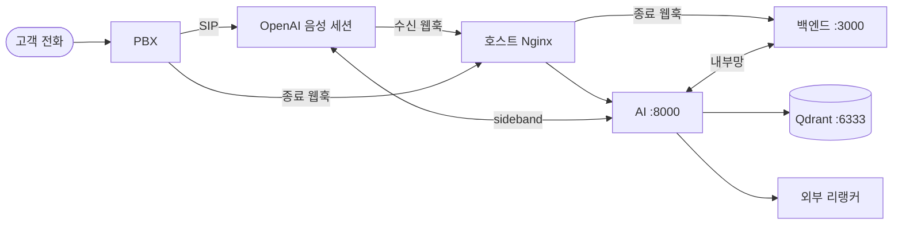
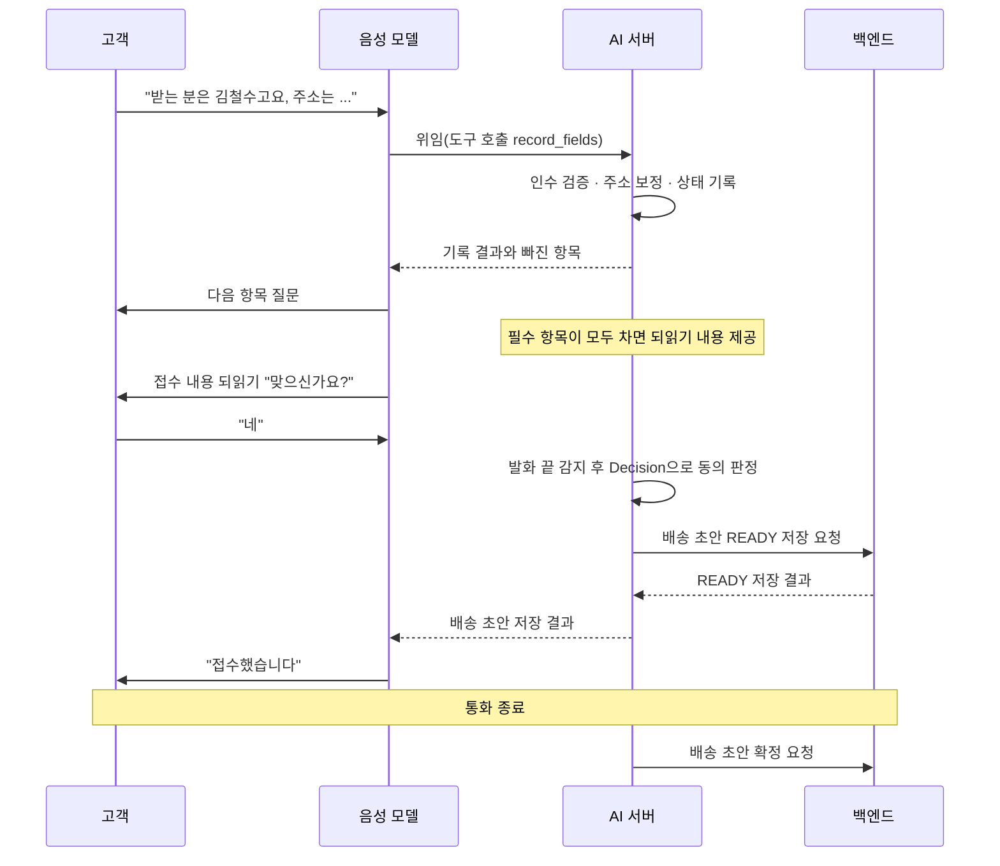
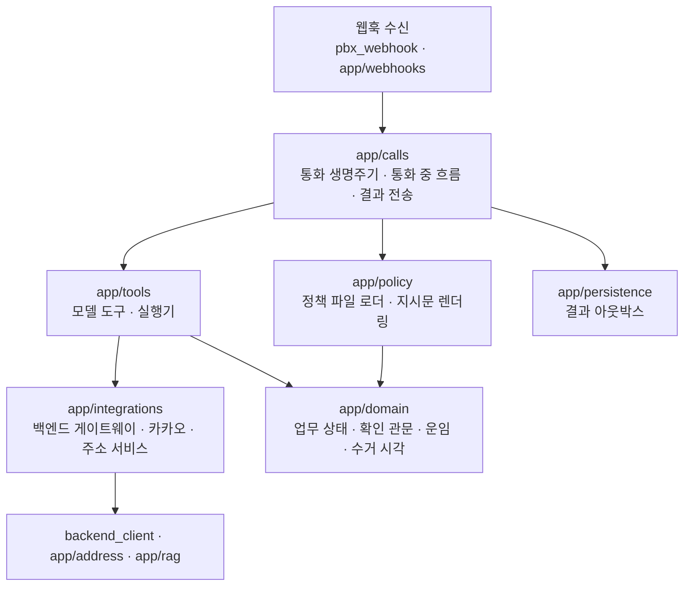

# AI 전화 접수 서비스 인계 문서

이 문서는 전화로 택배 접수·조회·취소·문의를 받는 AI 상담 서버의 코드 구조, 통화 흐름, 통합 배포에서 필요한 설정을 설명합니다.

- 통합 인계본의 백엔드 릴리스는 `7c7ec448ef2a-159`, AI 이미지의 빌드 기준은 `main`의 `7f47bee367a3`입니다.
- **운영 설치**는 통합 ZIP 안의 `README.md`, `docs/01-infrastructure.md`, `compose.prod.yaml`을 기준으로 합니다. 아래에서는 AI 담당자가 확인할 설정과 절차를 설명합니다.
- 저장소의 `ai/compose.yaml`은 AI와 Qdrant를 별도로 실행할 때 사용합니다. `BACKEND_MOCK=true`는 로컬 테스트에 사용하며, 통합 인계본은 실제 백엔드를 연결합니다.

## 1. 프로젝트 구조

### 1.1 폴더 구성

AI 파트의 코드는 저장소의 `ai/` 폴더에 모두 있습니다.

```
ai/
  app/
    main.py            서버 조립(공유 클라이언트, 라우터, 백그라운드 작업)
    calls/             통화 생명주기, 통화 중 흐름, 결과 전송, 페르소나 적용, 통화 후 검토
    domain/            업무 상태와 규칙(접수 항목, 확인 관문, 운임, 수거 시각)
    tools/             모델이 부르는 도구와 실행기
    policy/            정책 파일 로더와 지시문 렌더링
    integrations/      백엔드 게이트웨이, 카카오 주소 검색, 주소 보정 서비스
    address/           행정안전부 주소DB 기반 주소 보정
    rag/               FAQ 검색, FAQ 동기화, 리랭커 서버
    webhooks/          백엔드 → AI 알림(FAQ 변경, 페르소나)
    persistence/       결과 전송 아웃박스(SQLite)
    observability/     통화 trace와 구간 측정
  backend_client/      백엔드 API 클라이언트와 메모리 가짜 백엔드
  pbx_webhook/         OpenAI 수신 웹훅, PBX 통화 종료 웹훅
  policy/              업무 규칙, 기본 페르소나, 정책 정의(workflow.toml)
  config/              서버 설정(server.toml), FAQ 검색 설명
  prompts/             통화 후 검토 프롬프트
  manuals/             FAQ 원문
  persona_check/       페르소나 시험 창구(별도 컨테이너)
  call_analysis/       통화 불만 판정 기준 구현
  gpu/                 리랭커 서버 이미지
  deploy/              배포 스크립트와 compose 오버레이, GPU 서버 구축 스크립트
  scripts/             운영 점검 스크립트
  docs/, spec/         설계·계약·운영 문서
  Dockerfile           AI 서버 이미지
  compose.yaml         AI 서버와 Qdrant의 단독 실행용 Compose
  .env.example         환경변수 목록과 설명
```

### 1.2 구성 요소

통합 Compose에는 AI와 Qdrant가 별도 서비스로 들어 있습니다. 아래 표는 AI가 운영하거나 사용하는 구성 요소를 정리합니다.

| 구성 요소 | 하는 일 | 받는 포트 |
|---|---|---|
| AI 서버 | 전화를 받아 음성으로 응대하고 백엔드 API로 업무를 처리합니다 | 8000 |
| Qdrant | FAQ 검색용 벡터 DB. AI 서버만 접근합니다 | 6333 |
| 시험 창구(별도 배포) | 페르소나 적용 전 시나리오 통화 시험. 통합 Compose에는 포함되지 않습니다 | 8765 |
| 리랭커 | FAQ 검색 결과 재순위. FAQ 검색에 필요하며 별도 GPU 서버에 둡니다(10장) | HTTPS |

AI 서버가 연결되는 외부 시스템은 다음과 같습니다. 이들의 설치와 설정은 이 문서의 범위가 아닙니다.

| 시스템 | AI 서버와의 관계 |
|---|---|
| OpenAI | 음성 세션을 제공합니다. 전화가 오면 AI 서버의 수신 웹훅을 호출합니다 |
| PBX | 전화를 OpenAI로 넘기고, 통화가 끝나면 종료 웹훅을 보냅니다 |
| 백엔드 | AI 서버가 고객·주문·주소록·FAQ·페르소나 API를 호출하고 통화 기록을 보냅니다. 백엔드도 FAQ·페르소나 변경을 AI 서버에 알립니다 |

## 2. 흐름

### 2.1 연결 구조



- 백엔드, AI, Qdrant는 같은 Compose 프로젝트에서 별도 컨테이너로 실행됩니다. 백엔드는 `http://ai:8000`, AI는 `http://backend:3000`과 `http://qdrant:6333`을 사용합니다.
- AI의 호스트 바인딩은 `127.0.0.1:8000`입니다. 호스트 Nginx가 외부 HTTPS 웹훅을 전달합니다. Qdrant는 전용 내부망에 연결됩니다.

### 2.2 전화 한 통의 경로

1. 고객이 대표번호로 전화하면 PBX가 통화를 OpenAI의 SIP 주소로 넘깁니다.
2. OpenAI가 AI 서버의 수신 웹훅을 호출합니다. AI 서버는 서명을 확인하고 백엔드에서 발신번호로 고객을 조회한 뒤 통화를 수락합니다.
3. 통화 중에는 OpenAI 음성 모델이 고객과 대화하고, AI 서버는 sideband 연결로 통화를 지켜보면서 값 기록·조회·검증을 맡습니다.
4. 통화 중 AI 서버가 택배별 배송 초안을 저장합니다. 고객 확인과 검증을 마친 항목은 백엔드에 `READY`로 저장합니다.
5. 통화 종료 처리에서 AI 서버가 백엔드에 배송 초안 확정을 요청하고 통화 기록과 분석 결과를 전송합니다. PBX도 종료 웹훅을 보냅니다.

### 2.3 통화 중 처리 흐름



- 값을 기록하는 일(자유로운 말에서 값 뽑기)은 위임 모델과 도구가 맡습니다.
- 예/아니요 같은 선택형 판단은 서버가 고객 발화가 끝난 시점에 Decision 호출로 직접 판정합니다.
- 접수 확정과 취소는 모델이 부를 수 있는 도구가 아닙니다. 서버가 확인 관문을 통과한 뒤에만 실행합니다.
- 통합 인계본은 `[backend] parcel_draft_intake = true`를 사용합니다. 통화 중에는 변경 사항을 `EDITING`으로 저장할 수 있으며, 백엔드가 `READY` 저장을 응답한 경우에만 모델이 “접수했습니다”라고 안내합니다. 결제와 디버 접수는 백엔드가 처리합니다.

## 3. 설정

### 3.1 통합 인계본의 환경변수

통합 ZIP의 `.env.example`과 `ai.env.example`을 `~/dva-deploy/shared/.env`에 합쳐 디버 환경에서 사용할 값으로 채웁니다. 파일을 만드는 명령과 백엔드 측 필수값은 ZIP의 `docs/01-infrastructure.md`에 있습니다.

| 입력 항목 | 필수 여부 | 용도 |
|---|---|---|
| `OPENAI_API_KEY`, `OPENAI_WEBHOOK_SECRET` | 필수 | 음성 세션·위임·임베딩, 수신 웹훅 서명 검증 |
| `PBX_WEBHOOK_TOKEN` | 필수 | 공백 없는 32바이트 이상. Compose가 AI의 `PBX_WEBHOOK_SECRET`으로도 전달합니다 |
| `AI_BUSINESS_TOKEN` | 필수 | 고객·배송 초안·주소록·FAQ 조회 등 업무 API 인증 |
| `AI_INSIGHTS_TOKEN` | 필수 | 통화 기록·분석·미답변 질문 전송 |
| `AI_PERSONA_TOKEN` | 필수 | 페르소나 조회 및 적용 알림 |
| `AI_FAQ_TOKEN` | 필수 | FAQ 변경 알림 인증. 공백 없는 ASCII 32자 이상 |
| `QDRANT_API_KEY` | 필수 | Qdrant 접근 키 |
| `RAG_RERANKER_URL`, `RAG_RERANKER_API_KEY` | 필수 | 외부 HTTPS 리랭커 주소와 키 |
| `KAKAO_REST_API_KEY`, `ADDRESS_DATA_DIR` | 선택 | 카카오 주소 검색, 주소DB가 있는 호스트 디렉터리 |
| `BACKEND_MODEL`, `BACKEND_EFFORT`, `AI_LOG_LEVEL` | 선택 | 기본값은 각각 `gpt-6-luna`, `low`, `INFO` |

`AI_BUSINESS_TOKEN`, `AI_INSIGHTS_TOKEN`, `AI_PERSONA_TOKEN`, `AI_FAQ_TOKEN`은 각각 한 번 입력하면 Compose가 백엔드와 AI에 같은 값을 주입합니다. 서비스 주소도 Compose가 설정합니다.

### 3.2 로컬 개발

저장소에서 실행할 때는 `ai/.env.example`을 복사해 `ai/.env`를 만듭니다. `BACKEND_MOCK=true`를 명시하면 프로세스 메모리에 테스트 데이터를 저장합니다. 로컬 `uv` 실행에서 OpenAI 키를 설정할 경우 `BACKEND_MODEL`도 지정합니다. 실행 명령은 `ai/README.md`의 빠른 실행을 참고합니다.

### 3.3 설정 파일 적용

| 파일 | 배치와 적용 |
|---|---|
| `ai/config/server.toml` | 통합 릴리스에서 읽기 전용으로 마운트합니다. FAQ 동기화, 통화 상한, 백엔드 호출 제한 등을 바꾼 뒤 AI 서비스를 재시작합니다 |
| `ai/prompts/` | 통합 릴리스에서 읽기 전용으로 마운트합니다. 통화 후 검토 프롬프트를 바꾼 뒤 AI 서비스를 재시작합니다 |
| `ai/policy/` | AI 이미지에 포함됩니다. 업무 규칙이나 기본 페르소나를 변경하면 새 이미지를 빌드해 배포합니다 |
| `shared/.env` | 환경변수를 읽는 컨테이너를 배포 절차로 다시 생성해 적용합니다 |

## 4. AI 서버 아키텍처

### 4.1 역할 분담

AI 서버의 핵심 원칙은 **말은 음성 모델이 하고, 업무 사실은 서버가 확정한다**는 것입니다.

| 주체 | 맡는 일 |
|---|---|
| 음성 모델(`gpt-live-1`) | 한국어 대화, 끼어들기 응대, 다음에 물을 것 진행, 서버가 준 결과를 고객에게 안내 |
| 위임 모델(`BACKEND_MODEL`, 기본 `gpt-6-luna`) | 고객 말에서 값(성함·전화번호·주소·물품 등)을 뽑아 도구를 호출 |
| Decision 호출(`gpt-6-luna`) | 예/아니요, 후보 선택처럼 정해진 선택지 중 무엇인지 판정 |
| AI 서버(애플리케이션) | 인수 검증, 업무 상태 관리, 확인 관문, 백엔드 API 호출, 장애 복구, 결과 전송 |

모델이 절차를 건너뛰어도 빠진 값이 있는 주문은 확정되지 않습니다. 서버가 필수 항목이 모두 찼을 때만 되읽기 내용을 내주고, 고객이 그 내용에 동의했을 때만 저장하기 때문입니다.

### 4.2 모듈 구조



| 폴더 | 책임 |
|---|---|
| `app/main.py` | 서버를 조립합니다. 공유 HTTP 클라이언트, 라우터, 백그라운드 작업을 만들고 종료 때 닫습니다 |
| `pbx_webhook/`, `app/webhooks/` | 외부에서 들어오는 요청을 받습니다(OpenAI 수신, PBX 종료, 백엔드의 FAQ·페르소나 알림) |
| `app/calls/` | 통화 한 통의 수신부터 정리까지 담당합니다. 통화 중 도구 호출 처리, 확인 관문, 결과·기록 전송, 페르소나 적용이 여기 있습니다 |
| `app/domain/` | 업무 상태와 규칙입니다. 외부 SDK나 HTTP에 의존하지 않습니다 |
| `app/policy/` | `policy/workflow.toml`을 읽어 음성 모델·위임 모델의 지시문과 서버 판정 규칙을 함께 만듭니다 |
| `app/tools/` | 모델이 부르는 도구 5개와 서버 전용 동작(취소 등), 인수 검증과 실행 |
| `app/integrations/` | 백엔드 호출 게이트웨이(타임아웃·동시성 제한), 카카오 주소 검색, 주소 보정 서비스 |
| `backend_client/` | 백엔드 API 클라이언트와 메모리 가짜 백엔드 |
| `app/address/` | 행정안전부 주소DB로 들은 주소를 실제 주소로 보정합니다 |
| `app/rag/` | FAQ 검색(키워드 + 벡터 검색, 리랭커), 백엔드 FAQ와의 동기화 |
| `app/persistence/` | 통화 결과·기록을 전송 전에 SQLite에 저장하는 아웃박스 |

### 4.3 업무 상태와 확인 관문

- 통화마다 업무 상태 객체가 하나 있습니다. 접수 항목별 값, 검증 상태, 버전이 들어 있습니다.
- 접수 단계와 필수 항목, 확인 질문은 `policy/workflow.toml`에 정의합니다. 같은 파일에서 모델 지시문과 서버 판정 규칙을 만들기 때문에 둘이 어긋나지 않습니다.
- 되읽기는 서버가 필수 항목이 모두 찼을 때 만든 확인 내용으로만 합니다. 고객이 동의한 뒤 값이 바뀌었으면 확인을 다시 받습니다.
- 모델이 만든 도구 인수는 신뢰하지 않습니다. 형식 검증을 통과한 뒤에만 실행합니다.

### 4.4 결과 전송과 장애 대비

- 통화 결과와 기록은 보내기 전에 아웃박스(`state/outbox.sqlite3`)에 저장합니다. 서버가 재시작돼도 같은 키와 같은 본문으로 다시 보내므로 주문이 중복 생성되지 않습니다.
- 백엔드 호출에는 모두 타임아웃이 있습니다. 백엔드 장애는 고객 입력 오류와 구분해 처리합니다.
- 통화 중 Qdrant나 리랭커 장애가 발생하면 FAQ 검색은 `KB_UNAVAILABLE`로 처리합니다. 통합 Compose의 초기 기동은 Qdrant의 상태 확인을 기다립니다.
- 주소DB가 없으면 주소 보정 없이 들은 그대로 씁니다.

### 4.5 동시 통화

- 통화 상태가 프로세스 메모리에 있으므로 **AI 서버는 워커 1개로만 띄웁니다.** 여러 통화는 하나의 이벤트 루프에서 통화당 수신 작업 1개로 처리합니다.
- 동시 통화 상한은 `config/server.toml`의 `[call] max_active_calls`(기본 20)입니다.
- AI 서버를 다시 시작하면 진행 중인 통화가 끊깁니다. 재시작은 통화가 없는 시간에 하시기 바랍니다.

### 4.6 FAQ 검색

- 매뉴얼 원문(`manuals/`)이나 백엔드에서 관리하는 FAQ를 Qdrant에 색인하고, 질문이 오면 키워드 검색과 벡터 검색을 합친 뒤 리랭커로 다시 순위를 매깁니다.
- 임베딩 모델은 `text-embedding-3-large`, 리랭커는 별도 GPU 서버의 `Qwen3-Reranker-0.6B`입니다.
- 통합 인계본은 FAQ 수신과 처리가 켜져 있습니다. 백엔드가 변경을 알리면 AI가 최신 원문을 백엔드 API에서 조회해 관리용 컬렉션에 반영합니다.

### 4.7 보조 서비스와 기준 구현

| 서비스 | 용도 |
|---|---|
| 시험 창구(`persona_check/`) | 관리자가 페르소나를 적용하기 전에 가짜 고객과의 시나리오 통화로 시험합니다. 백엔드가 호출합니다. 별도 배포 방법은 `ai/persona_check/README.md`에 있습니다 |
| 통화 불만 판정(`call_analysis/`) | 끝난 통화의 불만·응대 오류를 판정합니다. 실서비스 구현은 백엔드 안에 있고, 이 폴더는 그 기준 구현입니다. 따로 띄우실 필요는 없습니다 |

더 자세한 설계는 `ai/docs/architecture/overview.md`에서 시작하시면 됩니다.

### 4.8 사용 모델과 API 사용료

통합 인계본의 모델 설정과 2026-11-21 기준 OpenAI 공개 가격입니다. 금액 단위는 USD이며 100만 토큰 단가는 표에 따로 표시했습니다.

| 사용처 | 모델 | 공개 사용료 |
|---|---|---|
| 전화 음성 상담(SIP) | `gpt-live-1` | 활성 세션 분당 $0.05, 초 단위 과금 |
| 통화 중 Responses 위임 | `gpt-6-luna`가 기본이며 `BACKEND_EFFORT=low` | 코드가 `priority`를 요청합니다. Fast 적용 시 표준의 2배로, 일반 입력 $0.20·출력 $1.00 / 100만 토큰 |
| 고객 동의·선택 판정 | `gpt-6-luna` 고정, Decisions API | 일반 입력 $0.10·캐시 입력 $0.01·캐시 쓰기 $0.125 / 100만 토큰. 출력 과금 없음 |
| 통화 후 미답변 검토 | `BACKEND_MODEL`, 기본 `gpt-6-luna`, Responses API | 표준 일반 입력 $0.10·캐시 입력 $0.01·캐시 쓰기 $0.125·출력 $0.50 / 100만 토큰 |
| FAQ 색인·검색 임베딩 | `text-embedding-3-large`, 3,072차원 | 입력 $0.13 / 100만 토큰 |
| FAQ 후보 재순위 | `Qwen/Qwen3-Reranker-0.6B` | 자체 호스팅. VM·디스크·네트워크 비용은 10.4절 참고 |

가격 근거는 [OpenAI API 가격표](https://developers.openai.com/api/docs/pricing), [GPT-6 Luna 모델 가격](https://developers.openai.com/api/docs/models/gpt-6-luna), [Decisions 요금](https://developers.openai.com/api/docs/guides/decisions#pricing-and-availability), [임베딩 모델 가격](https://developers.openai.com/api/docs/models/text-embedding-3-large)입니다.

- `BACKEND_MODEL`을 바꾸면 통화 위임과 미답변 검토에 적용됩니다. 음성, Decisions, 임베딩, 리랭커는 각각 위 표의 모델을 사용합니다.
- 음성 비용은 활성 세션 시간으로 산정하며, 통화 중 무음과 위임 대기도 청구 시간에 포함됩니다. 예를 들어 활성 3분이면 음성만 $0.15이고, 월 1,000통이면 $150입니다. 위임·판정·임베딩·후처리 사용료와 PBX 요금은 따로 더합니다. 실제 비용은 OpenAI 프로젝트의 사용량을 모델과 서비스 티어별로 확인합니다. [GPT-Live 과금 방식](https://developers.openai.com/api/docs/guides/voice-latency-cost) · [Fast 모드와 적용 티어](https://developers.openai.com/api/docs/guides/fast-mode)
- 별도 페르소나 시험 창구는 `gpt-6-luna`로 가상 고객·린트·판정을 처리하고, `gpt-4o-mini-tts`와 `gpt-4o-transcribe`로 시험 음성을 합성·전사합니다. TTS는 텍스트 입력 $0.60·음성 출력 $12.00 / 100만 토큰, 전사는 추정 분당 $0.006입니다. 백엔드의 통화 불만 판정도 별도 `gpt-6-luna` Responses 사용량이 발생합니다. [TTS 가격](https://developers.openai.com/api/docs/models/gpt-4o-mini-tts) · [전사 모델 가격](https://developers.openai.com/api/docs/pricing?latest-pricing-expanded=true)

## 5. 통합 설치

1. Linux amd64 서버에 Docker Engine과 Compose v2를 준비합니다. ZIP 설치 계정에서 `sudo -n docker`를 실행할 수 있어야 합니다.
2. 통합 ZIP을 `~/dva-deploy/releases/` 아래에 풀고, ZIP 안내에 따라 공용 `shared/.env`를 작성합니다. AI와 Qdrant 이미지는 `ai-images.tar`에 포함되어 있습니다.
3. 아래 명령으로 체크섬 확인, 이미지 로드, PostgreSQL 초기화, 관리자·FAQ·페르소나 등록, 서비스 기동과 상태 확인을 실행합니다. 최초 관리자 비밀번호는 실행 중 입력합니다.

```bash
release="$HOME/dva-deploy/releases/7c7ec448ef2a-159"
bash "$release/install.sh" dveradmin '운영 관리자'
```

초기 데이터 등록 이후 서비스 기동 단계에서 실패하면 ZIP의 `docs/01-infrastructure.md`에 따라 원인을 수정한 뒤 `deploy.sh`로 기동을 재시도합니다.

## 6. 외부 연동

- **OpenAI 웹훅**. 프로젝트에서 `live.transport.incoming` 이벤트를 구독하고 `https://<디버 도메인>/api/webhooks/openai/call-incoming`을 등록합니다. 발급된 비밀값을 `OPENAI_WEBHOOK_SECRET`에 입력합니다. 호스트 Nginx가 요청 본문과 서명 헤더를 AI로 전달합니다.
- **PBX SIP**. 트렁크 대상은 `sip:<OpenAI 프로젝트 ID>@sip.api.openai.com;transport=tls`입니다. 시그널링은 TLS(5061), 미디어는 SRTP를 사용합니다. 방화벽에서 허용할 미디어 대역은 `ai/docs/be-contract/ai/pbx-sip.md`를 참고합니다.
- **PBX 종료 웹훅**. 디버 도메인의 `POST /api/webhooks/pbx/call-ended`에 `Authorization: Bearer <PBX_WEBHOOK_TOKEN>`을 붙여 보냅니다. 호스트 Nginx가 백엔드에 전달하고, AI의 `POST /pbx/webhook/call-ended`로 같은 요청을 미러링합니다.
- **내부 API**. AI의 `/internal/*` 경로는 백엔드가 Compose 내부망에서 호출합니다. 공개 경로의 Nginx 설정은 ZIP의 `infra/https/https.conf`를 참고합니다.

AI가 받는 웹훅의 본문과 응답 코드는 `ai/docs/contracts/pbx-webhooks.md`에 있습니다.

## 7. 초기 데이터

### 7.1 주소DB

주소DB는 고객이 말한 주소를 실제 도로명주소로 보정하고 지번·법정동·우편번호를 채우는 데 사용합니다. 행정안전부가 배포하는 주소 텍스트 파일을 SQLite 파일(`address.db`) 하나로 변환해서 씁니다.

없을 때의 동작은 다음과 같습니다.

- 서버는 정상적으로 뜨고 통화도 받습니다. 주소는 보정 없이 들은 그대로 기록합니다.
- 지번·우편번호가 비어 접수 결과가 미완성으로 처리될 수 있습니다. `KAKAO_REST_API_KEY`가 있으면 카카오 주소 검색으로 보완합니다.

원본 파일은 한 폴더에 아래 네 종류가 모두 있어야 합니다.

| 파일 | 내용 |
|---|---|
| `개선_도로명코드_전체분.txt` | 전국 도로명 코드(1개) |
| `주소_<시도>.txt` | 시도별 건물 주소 |
| `지번_<시도>.txt` | 시도별 지번 |
| `부가정보_<시도>.txt` | 시도별 행정동·우편번호·건물명 |

- 원본은 행정안전부 주소기반산업지원서비스의 주소 내려받기 화면(https://business.juso.go.kr/jst/jstAddressDownload)에서 "주소DB" 전체분 자료를 받으시면 됩니다. 변동분이 아니라 전체분이어야 합니다. 파일 형식은 그 자료에 포함된 "주소DB 활용방법" 가이드의 붙임1을 기준으로 합니다.
- 원본은 CP949 인코딩 그대로 두셔야 합니다. UTF-8로 바꿔 저장하면 변환이 실패합니다.

변환은 `ai/` 폴더에서 아래 명령으로 실행합니다. 한 번만 하면 되고 10분 남짓 걸립니다. 결과 파일은 약 1GB입니다.

```bash
uv run python -X utf8 -m app.address.gazetteer "/경로/원본 폴더" data/address.db
```

- 진행하면서 시도별 건물·지번 건수를 출력하고, 마지막에 이름 색인 건수를 출력하면 완료된 것입니다.
- 중간에 실패하면 만들다 만 `data/address.db`가 남습니다. 지우고 다시 실행해 주시기 바랍니다.

적용 방법은 다음과 같습니다.

- 통합 설치에서는 `~/dva-deploy/shared/ai-data/address.db`에 둡니다. 다른 호스트 디렉터리를 쓰려면 `shared/.env`의 `ADDRESS_DATA_DIR`을 지정합니다. 로컬 프로세스는 `ai/data/address.db`를 기본으로 읽으며 `ADDRESS_DB`로 파일을 지정할 수 있습니다.
- AI 서버는 시작할 때 파일을 엽니다. 파일을 새로 넣거나 바꾼 뒤에는 AI 서버를 다시 시작해야 합니다.
- 적용됐는지는 로그로 확인합니다. "주소 보정 켜짐"이 보이면 적용된 것이고, "주소DB가 없어 주소 보정을 끕니다"라는 경고가 보이면 파일 위치를 확인해 주시기 바랍니다.

갱신하실 때는 다음을 참고하시기 바랍니다.

- 주소DB 자료가 새로 배포되면 새 원본으로 다시 변환해 파일을 교체합니다.
- 코드의 DB 구조가 바뀐 버전으로 올리실 때도 다시 변환해야 합니다. 옛 구조의 파일은 서버가 거부하므로 기동이 실패합니다.

### 7.2 FAQ

통합 설치는 빈 `qdrant_data` 볼륨으로 시작합니다. 설치 시 PostgreSQL에 등록한 FAQ 41건의 변경 알림을 백엔드가 전달합니다. AI는 `[faq_sync]`의 `receive_enabled`와 `process_enabled`가 켜진 상태에서 최신 원문을 조회해 관리용 컬렉션을 색인합니다. 색인에는 OpenAI 임베딩과 외부 리랭커의 문서 검증이 필요합니다.

1. ZIP의 `docs/01-infrastructure.md`에 있는 조회 명령으로 최초 INSERT 이벤트 상태가 `APPLIED`인지 확인합니다. `RETRY`가 계속되면 `last_error`와 AI 로그를 확인합니다.
2. 기존 FAQ에 변경 알림이 없을 때는 같은 안내의 `scripts.bootstrap_faq --enqueue` 명령을 AI 컨테이너 안에서 실행합니다.
3. 시험 통화에서 초기 FAQ에 포함된 질문을 해 실제 검색과 응답이 되는지 확인합니다.

저장소에서 매뉴얼 파일을 직접 색인하는 개발용 절차는 `ai/docs/ops/docker.md`를 참고합니다.

### 7.3 초기 상담 페르소나

통합 인계본을 처음 설치하면 기본 상담 페르소나로 **친절형**(v28)이 적용됩니다. 이름을 입력하고 목소리(초기값 `noeul`)를 선택한 뒤, 아래 여섯 항목에 상담 방식을 문장으로 적는 양식입니다. 톤과 속도는 양식에서 발화 스타일에 해당합니다.

| 양식 항목 | 무엇을 적나요? | 친절형의 초기 내용 |
|---|---|---|
| 역할 | 상담사가 누구이며 어떤 문의를 맡는지 적습니다 | 택배 상담사 ‘디바’로서 접수, 조회, 취소, 서비스 문의를 응대합니다. 고객이 AI인지 물으면 AI 상담원이라고 밝히고 용건으로 돌아갑니다 |
| 성격 | 고객을 대할 때 유지할 태도와 성향을 적습니다 | 밝고 열정적인 한국인 여성 상담사로, 접수 데스크 직원처럼 응대합니다 |
| 발화 스타일 · 톤 | 말하는 언어, 존댓말 여부, 어조와 문장 길이를 적습니다 | 밝은 한국어 존댓말로 간결하게 말합니다 |
| 발화 스타일 · 속도 | 말하는 빠르기와 문장 사이의 호흡을 적습니다 | 짧고 빠르게 말하며, 같은 말로 문장을 반복해서 시작하지 않습니다 |
| 맞장구 | 고객이 말하는 동안 어떤 반응을 언제, 얼마나 자주 할지 적습니다 | 고객이 주소를 말할 때 들은 주소를 작은 소리로 따라 말합니다. 맞장구는 작게, 가끔 칩니다 |
| 끼어들기 | 상담사가 말하는 중에 고객이 말을 시작하면 어떻게 응대할지 적습니다 | 문장 중간이라도 즉시 멈추고 고객의 말을 기다립니다 |

페르소나 작성 안내는 `gpt-live-1`의 성격, 말투, 속도, 맞장구, 끼어들기 설정을 다루는 OpenAI 공식 가이드를 참고했습니다. [OpenAI 공식 문서 · Prompting GPT-Live](https://developers.openai.com/api/docs/guides/live-prompting)

## 8. 동작 확인

| 확인 대상 | 기대 결과 |
|---|---|
| AI와 백엔드 | AI `/healthz`는 `{"ok":true}`를 반환합니다. 백엔드 내부 `/health/ready`에서 DB와 AI가 준비 상태인지 확인합니다 |
| FAQ 검색 | Qdrant `/readyz`가 성공하고, 초기 이벤트 `APPLIED`와 실제 FAQ 검색을 확인합니다 |
| 외부 수신 경로 | OpenAI 수신 URL에 서명 없는 POST를 보내면 AI가 400을 반환합니다. 404·502이면 Nginx 경로와 AI 서비스 상태를 확인합니다 |
| 초기 페르소나 | 관리자 화면에서 친절형(v28)이 적용되어 있는지 확인합니다 |
| 시험 통화 | 대표번호에서 인사말을 듣고 접수·FAQ를 시험합니다. 통화 중 배송 초안 저장과 통화 종료 후 확정 요청, PBX 종료 수신을 로그에서 확인합니다 |

인계본은 로컬 Docker의 빈 볼륨에서 기동과 초기 FAQ 41건의 색인·검색을 검증했습니다. 로컬 검증에는 모의 OpenAI·리랭커를 사용했습니다. 디버 환경에서는 실제 OpenAI·리랭커 연결과 PBX 통화를 확인합니다.

통화가 연결되지 않으면 AI 로그의 수신 웹훅 기록부터 확인합니다. 서명 검증 실패는 OpenAI 웹훅 비밀값을, 수락 후 종료는 OpenAI 키와 모델 설정을, 접수 실패는 `AI_BUSINESS_TOKEN`과 백엔드 응답을 확인합니다.

## 9. 운영

### 9.1 데이터가 있는 곳

AI 서버는 실행 위치 아래의 다음 경로에 데이터를 씁니다. 서버를 다시 만들어도 남도록 보존해야 합니다.

| 데이터 | 경로 | 개인정보 |
|---|---|---|
| 통화별 상세 기록(전사, 도구 호출) | `ai_logs` 볼륨의 `/app/logs/calls/<trace_id>.json` | 있음 |
| 미전송 결과(아웃박스) | `ai_state` 볼륨의 `/app/state/outbox.sqlite3` | 있음 |
| FAQ 동기화 대기열 | `ai_rag_state` 볼륨의 `/app/rag_state/faq-events.sqlite3` | 없음 |
| FAQ 색인 | `qdrant_data` 볼륨의 `/qdrant/storage` | 없음 |

이 경로의 파일을 지우면 해당 데이터가 사라집니다.

### 9.2 로그

AI 서버는 표준 출력으로 로그를 남기며, 통화마다 trace_id가 붙습니다.

통화 한 통을 자세히 보시려면 `logs/calls/<trace_id>.json`을 엽니다. 단계, 도구 호출 결과, 전사가 들어 있습니다.

## 10. 리랭커 서버 배포

리랭커는 FAQ 검색 후보를 질문과의 관련도로 다시 순위 매기는 서버입니다. AI 서버와 다른, GPU가 있는 서버에 따로 띄웁니다.

- 통합 Compose는 `RAG_RERANKER_URL`과 `RAG_RERANKER_API_KEY`에 값이 있어야 기동합니다. 가동 중 리랭커 연결이 실패하면 FAQ 문서 검증과 검색에 영향을 줍니다.
- 모델은 `Qwen/Qwen3-Reranker-0.6B`이며 버전(revision)이 코드에 고정돼 있습니다. AI 서버는 응답의 모델과 버전이 다르면 결과를 쓰지 않습니다.
- 코드는 `ai/app/rag/gpu.py`와 `ai/app/rag/qwen.py`, 이미지는 `ai/gpu/Dockerfile`입니다. AI 서버 이미지에는 들어가지 않습니다.

### 10.1 제공하는 API

| 경로 | 용도 | 인증 |
|---|---|---|
| `GET /health` | 상태 확인. 준비되면 `status`가 `ok`이고 모델 이름과 버전을 함께 돌려줍니다 | 없음 |
| `POST /rerank` | 질문 1개와 후보 최대 5개를 받아 점수를 돌려줍니다 | `Authorization: Bearer <RAG_RERANKER_API_KEY>` |
| `POST /validate-documents` | FAQ를 색인하기 전에 문서 길이가 모델 한도 안인지 확인합니다 | 위와 같음 |

### 10.2 연결 확인

AI 서버에 리랭커 주소와 키를 넣고 다시 시작한 뒤, AI 서버 로그에서 검색 준비 상태를 확인합니다.

"RAG 준비 미완료"라는 경고가 계속 보이면 리랭커 주소와 키, Qdrant 색인 상태를 확인해 주시기 바랍니다. 실제 검색은 통화 중 FAQ 질문으로 확인합니다.

### 10.3 GCP에 구축하는 스크립트

기존 리랭커 서버는 GCP의 GPU VM에 구축했습니다. 그때 쓴 스크립트와 절차가 `ai/deploy/gcp/`에 있습니다.

| 파일 | 하는 일 |
|---|---|
| `provision.ps1` | 전용 네트워크, 고정 IP, GPU VM 생성 |
| `bootstrap.sh` | GPU 드라이버, Docker, NVIDIA Container Toolkit 설치와 API 키 생성 |
| `bundle.py` | 리랭커에 필요한 소스만 묶음 |
| `install.sh` | 이미지 빌드, 모델 내려받기, systemd 서비스 등록 |
| `proxy.sh` | Caddy로 HTTPS 공개 |
| `control.ps1`, `remote.ps1`, `with-gpu.ps1` | VM 시작·중지와 원격 실행 |

- 스크립트 안의 프로젝트 이름과 주소는 `<GCP_PROJECT>`, `<RERANKER_IP>`로 바꿔 두었습니다. 사용하시려면 실제 값으로 채워야 합니다.
- 이 구성은 비용을 줄이기 위해 VM을 켤 때마다 30분 뒤 자동으로 중지되도록 설정돼 있습니다. 상시 운영하시려면 이 설정을 빼야 합니다.
- 자세한 절차는 `ai/deploy/gcp/README.md`에 있습니다.

### 10.4 GPU 사양과 운영 용량 산정

| 구분 | 확인된 구성 또는 측정값 |
|---|---|
| 개발·검증 환경 | GCP 서울 `asia-northeast3-a`의 `g2-standard-4`. NVIDIA L4 1개(24 GB VRAM), 4 vCPU, 시스템 RAM 16 GiB, `pd-balanced` 부팅 디스크 60 GB |
| 리랭커 실행 설정 | `Qwen/Qwen3-Reranker-0.6B` 고정 리비전, FP16, PyTorch 2.7.1 / CUDA 12.8. 질문과 후보 문서 한 쌍의 최대 입력은 1,024토큰이며 요청당 후보는 최대 5개 |
| 기존 L4 측정 | 모델 로드 후 GPU 메모리 약 1,480 MiB. 2026-10-31 외부 HTTPS 점검에서 예열 단건 5회 평균 약 100ms, 동시 3건 평균 183ms·최대 257ms. GPU 메모리는 모델 로드 직후 관측값이며 지연에는 네트워크 왕복 포함 |

구축·측정 기록은 `ai/deploy/gcp/README.md`에 있습니다. [Google Cloud G2 사양](https://docs.cloud.google.com/compute/docs/gpus/#g2-vms) · [서울 GPU 가용 구역](https://docs.cloud.google.com/compute/docs/regions-zones/gpu-regions-zones) · [Qwen 모델 카드](https://huggingface.co/Qwen/Qwen3-Reranker-0.6B)

**초기 운영 검증은 기존과 같은 L4 1대로 시작합니다.** 단일 질문의 소표본 점검만 있어 운영 최소 사양과 최대 처리량은 아직 확정할 수 없습니다. 통화 서버의 동시 통화 기본 상한 20건은 리랭커 처리량과 별개입니다. 리랭커는 워커 하나에서 추론과 FAQ 등록용 문서 검증을 같은 잠금으로 직렬화하므로, 부하가 겹칠 때 대기 시간이 쌓일 수 있습니다.

1. 운영에서 예상하는 피크 FAQ 요청률(초당 요청 수)과 동시 요청, 후보 길이를 정합니다. 실제 문의 분포에 가까운 질문을 쓰고, 후보 5개와 입력 한도에 가까운 사례, FAQ 등록·색인이 겹치는 구간을 포함합니다.
2. AI 서버가 배포될 네트워크에서 예열 후 목표 요청률과 짧은 집중 부하를 재현합니다. 외부 `/rerank`와 전체 FAQ 검색의 p95·p99 지연, 처리량, 타임아웃·오류율을 기록합니다. GPU 최대 VRAM과 사용률은 `nvidia-smi`로 함께 측정합니다. 재기동 후 `/health` 준비 시간도 따로 기록합니다.
3. 고객이 답을 기다릴 수 있는 시간과 허용 오류율을 먼저 정하고, 피크에서도 충족하는지 확인합니다. 현재 RAG 설정의 HTTP 타임아웃은 5초, 전체 검색 제한은 12초입니다. 피크에서 추론 대기가 병목이면 더 빠른 GPU 또는 리랭커 인스턴스 분산을 비교합니다. 네트워크나 임베딩이 병목이면 해당 구간부터 점검합니다.

리랭커 연결과 응답 형식은 리랭커 환경변수를 주입한 상태에서 `ai/`의 `uv run python -m scripts.check_remote_reranker`로 먼저 확인할 수 있습니다. 단건 6회와 동시 3건을 쓰는 이 스크립트는 연결 점검용입니다.

**VM 비용**은 서울 리전의 `g2-standard-4` 온디맨드 단가에 월 가동 시간을 곱하고, 디스크·외부 IP·네트워크 요금을 더해 산정합니다. 24시간 운영 예산은 월 730시간으로 견적을 비교합니다. 개발 VM은 30분 후 자동 중지되므로 운영 VM에서는 서비스 시간에 맞게 운용 정책을 설정합니다. [Google Cloud GPU VM 요금](https://cloud.google.com/products/compute/pricing/accelerator-optimized) · [Google Cloud 요금 계산기](https://cloud.google.com/products/calculator)

## 11. 문서 지도

| 알고 싶은 것 | 문서 |
|---|---|
| 통합 ZIP 운영 설치·초기 색인 | ZIP의 `README.md`, `docs/01-infrastructure.md` |
| AI 서버 폴더 구성과 로컬 실행 | `ai/README.md` |
| 설계 전체 | `ai/docs/architecture/overview.md` |
| 통화 생명주기, 동시성, 장애 복구 | `ai/docs/architecture/call-lifecycle.md`, `concurrency.md`, `error-recovery.md` |
| 위임과 Decision, 확인 관문 | `ai/docs/architecture/delegation.md`, `conversation-state.md`, `workflow-policy.md` |
| 설계 결정 기록 | `ai/docs/architecture/decisions.md` |
| 백엔드 API 계약 | `ai/docs/be-contract/`, `ai/docs/contracts/be-api.md` |
| 웹훅 계약 | `ai/docs/contracts/pbx-webhooks.md` |
| 도구 계약 | `ai/docs/contracts/tool-contracts.md` |
| 업무 규칙과 통화 시나리오 | `ai/policy/`, `ai/docs/call-flow/` |
| FAQ 검색과 동기화 | `ai/spec/rag.md`, `ai/spec/faq-sync.md`, `ai/docs/rag-handoff.md` |

## 12. 테스트를 새로 작성하실 때

- `ai/pyproject.toml`의 dev 의존성에 `pytest`와 `httpx`가 있습니다. `uv sync` 후 `uv run pytest`로 실행합니다.
- `backend_client/mock.py`의 메모리 가짜 백엔드를 쓰면 실제 백엔드 없이 통화 흐름을 시험하실 수 있습니다. 서버에서 `BACKEND_MOCK=true`로 쓰는 것과 같은 구현입니다.
- 순수 로직인 `app/domain/`, `app/policy/`, `app/address/`부터 작성하시면 외부 의존 없이 시작할 수 있습니다.
- 테스트를 추가하시면 `ai/Jenkinsfile`의 `Check` 단계에 `pytest` 실행을 넣어 주시기 바랍니다.

## 13. 인계 전 정리한 것

깔끔한 인계를 위해 개발 과정에서 쌓인 산출물을 `ai/` 폴더에서 정리했습니다. 운영에 쓰이는 코드와 계약 문서는 그대로입니다.

| 정리한 것 | 내용 |
|---|---|
| 테스트 파일 | 단위·계약 테스트와 픽스처 전부입니다. 필요하시면 pytest로 새로 작성하실 수 있습니다(12장) |
| 작업 내역 문서 | 작업 기록(worklog), 실험 결과 기록 |
| 아키텍처 설계 계획안 | 구현이 끝난 계획·감사·조사 문서, 재구성 전 분석 문서, 옛 흐름 엔진 문서 |
| 이전 버전 코드 | 재작성 전 서버 폴더 |
| 임시 관제 화면 | 개발 중 통화를 눈으로 확인하던 화면과 그 연결 코드 |
| 평가 도구 | 검색·주소 보정 품질을 재던 스크립트와 평가 데이터 |
| 서버 주소 | 배포 서버·리랭커 서버 주소와 클라우드 프로젝트 이름을 플레이스홀더로 바꿨습니다 |

남긴 것 중 알아 두실 점은 다음과 같습니다.

- `AGENTS.md`, `CLAUDE.md`는 개발 중 쓰던 AI 코딩 도구용 지침입니다. 필요에 따라 지우거나 다시 쓰셔도 됩니다.
- `call_analysis/tests/test_call_analysis.py` 하나는 남겼습니다. 백엔드의 `scripts/record-complaint-parity.py`가 실행하는 기준 테스트입니다.
- `backend_client/`에는 백엔드 계약에 맞춰 구현했지만 현재 통화 흐름이 호출하지 않는 메서드가 일부 있습니다(주문 수정, 주소록 목록·수정 등).
