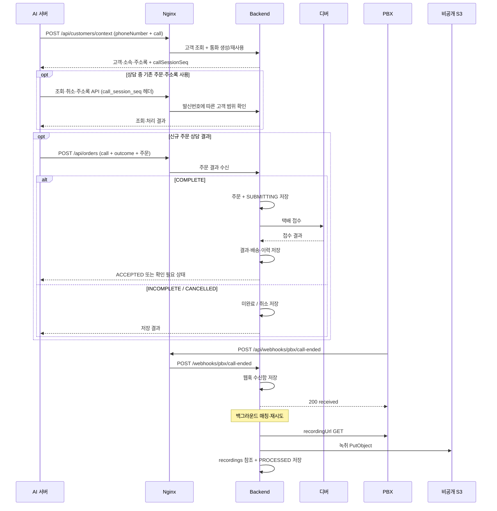

# AI·PBX 주문 결과 및 녹취 연동

결제·가격·부분 취소의 현재 규격과 요청·응답 전체 예시는 [AI 주문 결제 연동 규격](ai-order-billing-integration.md)을 따른다. COMPLETE는 개인 카드 결제 완료를 뜻하지 않는다.

AI 팀 전달용 요청·응답 요약은 [짧은 연동 명세](ai-integration-quickstart.md)를 참고한다.

## 호출 순서



같은 Docker 네트워크에서는 AI가 `http://backend:3000/api/...`를 직접 호출할 수 있다. 공개 경로는 `https://13.209.59.180/api/...`이고 Nginx가 백엔드로 전달한다. PBX의 외부 `/api/webhooks/pbx/call-ended`만 내부 `/webhooks/pbx/call-ended`로 변환한다.

## 1. 고객 확인

`POST /api/customers/context`:

```json
{
  "phoneNumber": "01012345678",
  "call": {
    "providerCallId": "sess_example",
    "incomingAt": "2026-10-29T01:00:00Z"
  }
}
```

번호는 국내 숫자 문자열로 변환한다. `+8210...`는 `010...`이다. 응답은 `data.lookupStatus`, `data.customer`, `personalPins`, `companyPins`, `callSessionSeq`를 포함한다. companyPins는 폐기된 호환 필드로 항상 빈 배열이다. 기본 출발지는 customer의 현재 이름·전화번호·address, 기업 배송지는 GET /api/companies/search를 사용한다. 자세한 필드는 [고객 초기 조회 계약](caller-context.md)을 따른다. 통화를 생성·재사용하며 고객·주문은 생성하지 않는다.

상담 중 주문 조회·취소·주소록 API는 응답의 callSessionSeq를 `call_session_seq` 헤더로 받는다. 같은 통화 ID·발신번호·수신 시각의 재요청은 같은 번호를 반환한다. 기존 phoneNumber만 보낸 요청은 조회만 수행하고 통화 번호를 반환하지 않는다.

## 2. 상담 결과 전송

`POST /api/orders`, `Content-Type: application/json`, **`Idempotency-Key: UUID`**.
`call_session_seq` 헤더나 `/submit` 후속 호출은 필요 없다. 완료 예시의 수거 시각은 실행 시점의 미래 시각으로 바꾼다.

```json
{
  "outcome": "COMPLETE",
  "call": {
    "providerCallId": "sess_example",
    "callerPhoneNumber": "01012345678",
    "incomingAt": "2026-10-29T01:00:00Z"
  },
  "customer": { "name": "발신 고객", "phoneNumber": "01012345678" },
  "paymentMethodType": "billing",
  "totalAmount": 3500,
  "pickupRequestedAt": "2026-10-30T10:00:00+09:00",
  "parcels": [{
    "origin": {
      "name": "발송인", "phoneNumber": "01012345678",
      "roadAddress": "서울시 예시로 1", "jibunAddress": "서울시 예시동 1",
      "detailAddress": "101호", "dongName": "예시동", "postalCode": "01234",
      "latitude": 37.5, "longitude": 127
    },
    "destination": {
      "name": "수령인", "phoneNumber": "01087654321",
      "roadAddress": "서울시 배송로 2", "jibunAddress": "서울시 배송동 2",
      "detailAddress": "", "dongName": "배송동", "postalCode": "05678",
      "latitude": 37.6, "longitude": 127.1
    },
    "smallBoxCount": 1,
    "itemPrice": 10000,
    "notifiedPrice": 3500,
    "clientComment": "문 앞 배송"
  }]
}
```

- 기존 고객 번호를 아는 경우 `customer` 대신 `customerSeq`를 보낸다.
- `COMPLETE`: 고객이 최종 내용을 확인한 뒤 전송. 개인 카드는 결제를 기다리고 월·그룹결제는 결제 완료 후 백엔드가 디버를 호출하며 `data.status=ACCEPTED`일 때만 AI가 성공을 안내한다.
- `INCOMPLETE`: 중도 종료·상담사 연결. 같은 구조로 수집한 항목만 전송한다. 고객 이름이 없으면 customer를 생략할 수 있다.
- `CANCELLED`: 디버에 접수하기 전 상담 중 취소. 접수된 주문을 취소하는 기능이 아니다.
- `call.incomingAt`은 수신 이벤트 **`created_at`(Unix 초)**으로 만든 ISO 8601이다. 세션 ID·발신번호와 함께 최초 수신 때 보관하고, 종료 결과 전송까지 유지한다.
- 고객 확인 때와 같은 통화 정보를 보내면 기존 통화에 주문을 연결한다. 고객 확인 없이 결과를 먼저 보낸 기존 호출도 통화를 생성할 수 있다.
- 세션 ID와 요청 UUID는 다른 값이다. 주문 한 건의 재시도는 같은 UUID·같은 call을 사용한다. 같은 통화의 여러 택배는 `parcels`에 묶는다.
- COMPLETE 전송을 시작한 뒤 전화가 끊겨도 별도 INCOMPLETE/CANCELLED 주문을 만들지 않는다. 기존 UUID로 상태를 확인한다.
- 네트워크 실패·504·409 처리 중·202는 새 키를 만들지 말고 기존 키로 재확인한다. `SUBMISSION_FAILED`는 자동 재접수하지 않는다.
- AI HTTP timeout은 디버 대기 10초보다 여유 있게 설정한다. 현재 호스트 프록시 제한에서 응답이 먼저 끊겨도 같은 키 재확인으로 결과를 얻는다.

응답은 `{data:{orderSeq,version,status,callSessionSeq,parcelNo},meta:{requestId}}`다. 실패한 HTTP 요청은 기존 `{error:{code,message,details},meta}` 계약이다. 주문 입력·오류 상세는 [주문 계약](orders.md)을 따른다.

## AI 팀이 맞출 부분

이번 브랜치는 백엔드와 명세만 변경한다. 현재 develop-ai의 다음 호출 규격은 아직 수정되지 않았다.

| 기존 AI 호출/가정 | 적용할 계약 |
| --- | --- |
| `/internal/ai/callers/context`, `{phone}` | `/api/customers/context`, `{phoneNumber,call:{providerCallId,incomingAt}}`. 응답 callSessionSeq 보관 |
| `/internal/ai/orders`, 납작한 snake_case 주소 | `/api/orders`, 위 camelCase·parcels 구조 |
| 세션 ID-순번을 요청 키로 사용 | 주문별 UUID를 생성·보관하고 재전송 시 유지 |
| 납작한 `order_no` 응답 | `data.orderSeq`, `data.status`, `data.parcelNo` |
| 로컬 `time.time()`을 통화 기준으로 사용 | OpenAI 수신 이벤트 `created_at` 전달 |
| 중간 주문 저장 후 별도 submit | 상담 결과 한 번 전송, 완료 결과에서 백엔드가 디버 접수 |

완료 입력에는 도로명·지번 주소·동명·우편번호·좌표·미래 수거 시각·물품 가액까지 필요하다. 문자열 주소만 보내거나 미수집 값을 임의 기본값으로 채우지 않는다. 카드 방식은 `billing`(개인·기업 카드, 기본값), `credit`(월결제 자격), `groupBilling`(부서 그룹결제 자격)만 사용한다.

## 3. PBX 종료 웹훅

외부 `POST /api/webhooks/pbx/call-ended`, `Authorization: Bearer <PBX_WEBHOOK_TOKEN>`.

```json
{
  "recordingId": "recording-example",
  "callFrom": "01012345678",
  "callTo": "07012345678",
  "startedAt": "2026-10-27T01:00:00Z",
  "endedAt": "2026-10-27T01:03:00Z",
  "durationSeconds": 180,
  "recordingUrl": "https://dvercorp-aicc-connect-dev-recordings.s3.ap-northeast-2.amazonaws.com/example.mp3"
}
```

응답은 기존 `{status:"received",recordingId,duplicate}`이며 S3 완료 응답이 아니다. 같은 ID·같은 정규화 본문은 200 중복, 다른 본문 재사용은 409, DB 저장 실패는 503이다. 서명 URL을 쓰면 다운로드 시점까지 유효해야 한다. URL만 바꾼 재전송도 현재 수신 계약에서는 다른 본문이다.

## 4. 통화 매칭과 S3

- 기본 후보 조건: 국내 표기로 정규화한 발신번호가 같고, OpenAI `incoming_at`과 PBX `startedAt` 차이가 **±30초** 이내.
- 30초는 초기 보수적 설정이며 실측으로 확정한 값이 아니다. `RECORDING_MATCH_WINDOW_SECONDS`(1~300초)로 조절한다. 통화 길이·종료 시각만으로 가장 가까운 다른 통화에 연결하지 않는다.
- 수신 후 최소 1분을 기다려 짧은 도착 순서 역전을 흡수한다. 후보가 정확히 한 개일 때만 연결한다. 없음·여러 개는 RECEIVED로 보류한다.
- 처음 선택한 `call_session_seq`를 기존 수신함에 저장한다. 업로드 재시도 때는 후보를 다시 선택하지 않는다. 시작·종료 시각은 `call_sessions`, PBX 추가 원문은 수신함에 남는다.
- 비공개 S3에 `recordings/<recordingId의 SHA-256>` 키로 저장한다. URL·전화번호를 객체 이름에 넣지 않는다.
- S3 성공 후 `recordings(call_session_seq,object_key)`와 수신함 PROCESSED를 같은 DB 트랜잭션으로 저장한다.
- 실패는 FAILED로 보관한다. 10초마다 최대 5건씩 확인하며 최초 포함 5회, 실패 후 1·5·15·30분 간격으로 재시도한다. 정책 위반·상한 초과는 확인 대기이며 기존 잠금과 PBX 계약은 유지한다. [054 이행·운영 재개](../../backend/docs/recording-retry-policy.md)를 따른다.
- S3 업로드 후 DB 저장이 실패해도 기존 객체를 HEAD로 확인해 재사용한다. 원본 URL 만료 후에도 이미 저장한 파일을 다시 다운로드하지 않는다.
- 후보가 늦게 추가되거나 타임스탬프가 잘못된 경우 번호·시각만으로 절대적인 동일 통화 증명을 할 수는 없다. 1분보다 긴 지연이나 모호한 후보는 운영 확인 대상이다. PBX가 같은 providerCallId를 전달할 수 있게 되면 직접 키 매칭으로 바꾸는 것이 확실하다.

S3 버킷이 비어 있으면 업로드 워커만 비활성화하고 웹훅은 계속 보존한다. 실제 설정과 보류 확인 SQL은 [S3 설정 문서](recording-s3-setup.md)를 따른다.
